# Netlas CookBook <!-- omit in toc -->

<span class="hidden">
     
    
    <br>
    
    <!--img src="https://hits.seeyoufarm.com/api/count/incr/badge.svg?url=https%3A%2F%2Fgithub.com%2Fnetlas-io%2Fnetlas-cookbook&count_bg=%2379C83D&title_bg=%23555555&icon=&icon_color=%23E7E7E7&title=hits&edge_flat=false"/-->
    <br><br>
</span>

The **goal** of this guide is to teach anyone interested in cybersecurity, regardless of their knowledge level, how to make the most of Netlas Search Tools. This is a long read. We have collected as many simple use cases as possible and demonstrated how to automate them.

⭐️ Give us a star to show your appreciation   
👁️ Subscribe for updates

**Netlas** is a search engine designed to find and analyze indexed information about internet-facing IP addresses and domains. Netlas has some attack surface management features, but this guide focuses mostly on Netlas Search Tools and how to use them in automations.

## Table of Contents <!-- omit in toc -->

- [Simple Usage Examples](#simple-usage-examples)
  - [Getting Information About IP or Domain](#getting-information-about-ip-or-domain)
  - [Search for Non-Latin Domains](#search-for-non-latin-domains)
  - [Looking for Websites That Contain a Certain Word in Their Title](#looking-for-websites-that-contain-a-certain-word-in-their-title)
- [Search Query Syntax](#search-query-syntax)
  - [Filters (Fields)](#filters-fields)
  - [Logical Operators](#logical-operators)
  - [Ranges](#ranges)
  - [Wildcards](#wildcards)
  - [Fuzziness](#fuzziness)
  - [Regular Expressions](#regular-expressions)
  - [Other Netlas.io Search Features](#other-netlasio-search-features)
- [API Requests](#api-requests)
  - [How to Find the API-key?](#how-to-find-the-api-key)
  - [Tools for Debugging API Requests](#tools-for-debugging-api-requests)
  - [Structure of Netlas API JSON Response](#structure-of-netlas-api-json-response)
  - [Tools for Working with Data in JSON Format](#tools-for-working-with-data-in-json-format)
  - [Netlas Python Library](#netlas-python-library)
  - [Examples of Response Keys for Getting Useful Data](#examples-of-response-keys-for-getting-useful-data)
  - [Netlas Python Response Datatypes](#netlas-python-response-datatypes)
  - [Netlas CLI Tools](#netlas-cli-tools)
  - [Search vs Download vs Host Methods](#search-vs-download-vs-host-methods)
  - [Additional Request Parameters](#additional-request-parameters)
  - [Make Requests with Python (without Netlas Python Library)](#make-requests-with-python-without-netlas-python-library)
  - [Examples for Other Programming Languages](#examples-for-other-programming-languages)
  - [JQ Utility](#jq-utility)
  - [AI Tools for Writing Code](#ai-tools-for-writing-code)
  - [Code Checkers](#code-checkers)
- [Using Netlas.io for OSINT (Open Source Intelligence)](#using-netlasio-for-osint-open-source-intelligence)
  - [Search IP WHOIS Contact Emails](#search-ip-whois-contact-emails)
  - [Search for Person's Nickname or Email in Title and Body of Web Page](#search-for-persons-nickname-or-email-in-title-and-body-of-web-page)
  - [Search Your Site for Public Document Mentions](#search-your-site-for-public-document-mentions)
  - [Phone Number Mentions Search](#phone-number-mentions-search)
  - [Search File Mentions (Looking for Content That May be Infringing on Copyrights)](#search-file-mentions-looking-for-content-that-may-be-infringing-on-copyrights)
  - [Domain WHOIS Information Gathering](#domain-whois-information-gathering)
  - [Search Extracted Contact Addresses](#search-extracted-contact-addresses)
  - [Search Author Name in Meta Tags](#search-author-name-in-meta-tags)
  - [What Other Interesting Things Can Be Found in the Meta Tags of HTML Document?](#what-other-interesting-things-can-be-found-in-the-meta-tags-of-html-document)
  - [Search by FTP Server's Banners Text](#search-by-ftp-servers-banners-text)
  - [Search for Contact Information in TLS Certificates](#search-for-contact-information-in-tls-certificates)
  - [Inspect Historical HTTP Responses](#inspect-historical-http-responses)
  - [9 Ways to Search Related Websites](#9-ways-to-search-related-websites)
- [Scraping (Extract Data from Web Page Body)](#scraping-extract-data-from-web-page-body)
  - [Beautiful Soup Package](#beautiful-soup-package)
  - [Re Package](#re-package)
  - [Other Python Packages for Scraping](#other-python-packages-for-scraping)
- [Using Netlas.io for Crypto Investigations](#using-netlasio-for-crypto-investigations)
  - [Search Mining Farms](#search-mining-farms)
  - [Search for Historical Cryptomining References](#search-for-historical-cryptomining-references)
  - [Inventory Potential Bitcoin Nodes](#inventory-potential-bitcoin-nodes)
- [Using Netlas for Pentest](#using-netlas-for-pentest)
  - [Subdomain Search](#subdomain-search)
  - [Search for Sites with Specific Vulnerabilities](#search-for-sites-with-specific-vulnerabilities)
  - [Search for Sites with Vulnerabilities That Contain a Certain Word in Their Descriptions](#search-for-sites-with-vulnerabilities-that-contain-a-certain-word-in-their-descriptions)
  - [Search by Server HTTP Header](#search-by-server-http-header)
  - [Match an Inventory Favicon by Hash](#match-an-inventory-favicon-by-hash)
  - [Search by Technology Tag](#search-by-technology-tag)
  - [Filter CVE Annotations by IP Geolocation](#filter-cve-annotations-by-ip-geolocation)
  - [Search for Login/Admin Panels](#search-for-loginadmin-panels)
  - [Inventory Database Administration Interfaces](#inventory-database-administration-interfaces)
  - [Check for Database Error Text](#check-for-database-error-text)
- [IoT Search: 9 Basic Ways](#iot-search-9-basic-ways)
  - [Search by Title](#search-by-title)
  - [Search Inside Body](#search-inside-body)
  - [Search by Port  Number](#search-by-port--number)
  - [Search by Banner](#search-by-banner)
  - [Search by Favicon](#search-by-favicon)
  - [Search by Server Headers](#search-by-server-headers)
  - [Search by Cookies](#search-by-cookies)
  - [Search by Tag](#search-by-tag)
  - [Additional Search Filters](#additional-search-filters)
- [Using Netlas.io for Darknet Research](#using-netlasio-for-darknet-research)
  - [Tor Exit Nodes Search](#tor-exit-nodes-search)
  - [Collecting Links to .onion Sites](#collecting-links-to-onion-sites)
- [Files, Backups and Logs Directories Search](#files-backups-and-logs-directories-search)
- [Using Netlas.io for Digital Forensics and Incident Response](#using-netlasio-for-digital-forensics-and-incident-response)
  - [SMTP Servers Information Gathering](#smtp-servers-information-gathering)
  - [Search for Domains That Could Potentially Be Used for Phishing](#search-for-domains-that-could-potentially-be-used-for-phishing)
  - [Favicon Search](#favicon-search)
  - [Search for Domains Associated with a Specific Subnet](#search-for-domains-associated-with-a-specific-subnet)
  - [Check an Incident Host for a Title Indicator](#check-an-incident-host-for-a-title-indicator)
- [Search for Technologies and Code Examples](#search-for-technologies-and-code-examples)
- [Common Problems](#common-problems)
  - [Error 429 - Too Frequent Requests](#error-429---too-frequent-requests)
  - [KeyError](#keyerror)
  - [Automation of Work with the List of Requests](#automation-of-work-with-the-list-of-requests)
  - [Saving Data in CSV Format](#saving-data-in-csv-format)
  - [Saving Data in Other Formats](#saving-data-in-other-formats)
  - [Decoding Punycode Domains](#decoding-punycode-domains)
  - [What to Do If Search Queries Don't Return Results?](#what-to-do-if-search-queries-dont-return-results)
  - [Removing HTML Tags from HTTP Body](#removing-html-tags-from-http-body)
- [Attack Surface Management](#attack-surface-management)
- [Working with Very Large Amounts of Data](#working-with-very-large-amounts-of-data)
- [Acknowledgments](#acknowledgments)

## Simple Usage Examples

Netlas includes several search tools:

- **IP/Domain info** [→](https://app.netlas.io/host/)   
- **Response search** [→](https://app.netlas.io/responses/)  
- **DNS search** [→](https://app.netlas.io/domains/)   
- **IP WHOIS search** [→](https://app.netlas.io/whois_ip/)   
- **Domain WHOIS search** [→](https://app.netlas.io/whois_domains/)   
- **Certificates search** [→](https://app.netlas.io/certs/)  

We will mostly use Responses search (internet scan results), and the other search tools have a similar interface. Each collection has its own fields.

Before we get into the technical details, let's see how [Netlas.io](https://app.netlas.io/) works with a few simple examples.

### Getting Information About IP or Domain

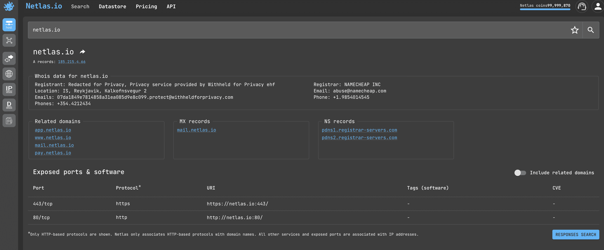

Open [Netlas.io IP/Domain info](https://app.netlas.io/host/netlas.io/) and enter the domain name or IP. Depending on the input, data, and plan, you may see fields such as these.

* whois data (registrant, location, emails, phones)
* related domains
* MX and NS records
* exposed ports and detected software for IP addresses, plus any available CVE annotations

### Search for Non-Latin Domains

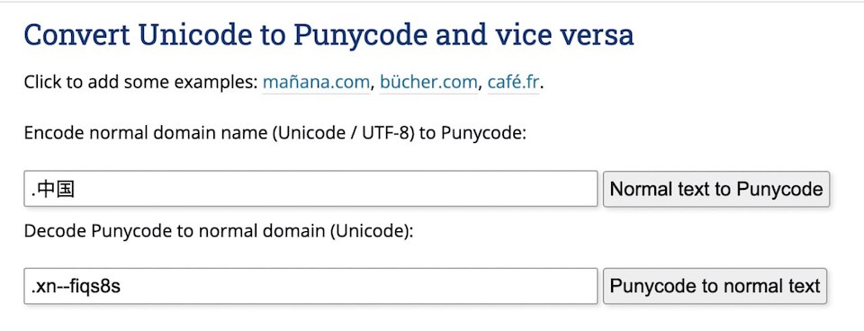

Use the ASCII form of an internationalized domain name in DNS Search. This example uses the Punycode form of `.中国`.

```text
domain:*.xn--fiqs8s
```

Python can convert the label locally with `"中国".encode("idna").decode("ascii")`. [Try in Netlas](https://app.netlas.io/domains/?q=domain%3A%2A.xn--fiqs8s) · [Punycode specification](https://www.rfc-editor.org/rfc/rfc3492)

### Looking for Websites That Contain a Certain Word in Their Title

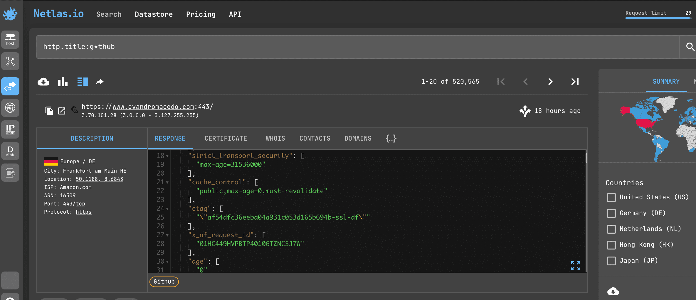

Open [Netlas.io response search](https://app.netlas.io/responses/) and enter the following query.

```text
http.title:g*thub
```

[Try in Netlas](https://app.netlas.io/responses/?q=http.title%3Ag%2Athub)

This will find titles containing a word that starts with `g` and ends with `thub`. Read more about [using asterisks](#wildcards) below.

## Search Query Syntax

Now let's learn more about how search queries work in [Netlas.io](https://app.netlas.io/).

Netlas uses Apache Lucene query syntax. The field type determines which operators apply and how the value is matched. [Netlas Search Query Language](https://docs.netlas.io/knowledge-base/query-language/)

### Filters (Fields)

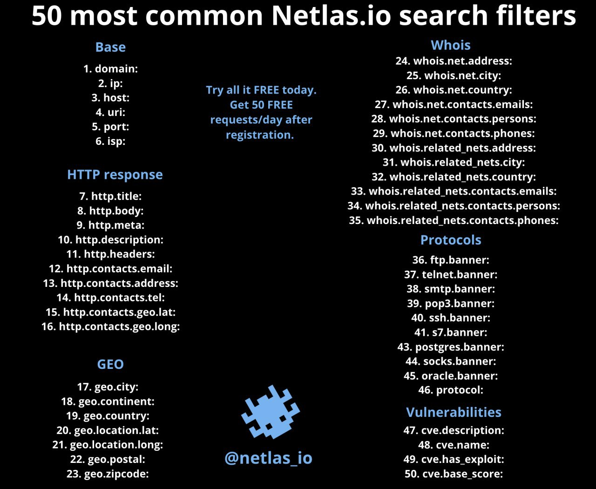

The search collections allow you to use filters (fields) in search queries.

```text
http.body:netlas
```

You can use this query to find indexed HTTP responses that contain the word `netlas` in the body.

You can find a list of available filters for each search type in the Mapping tab of the search sidebar.

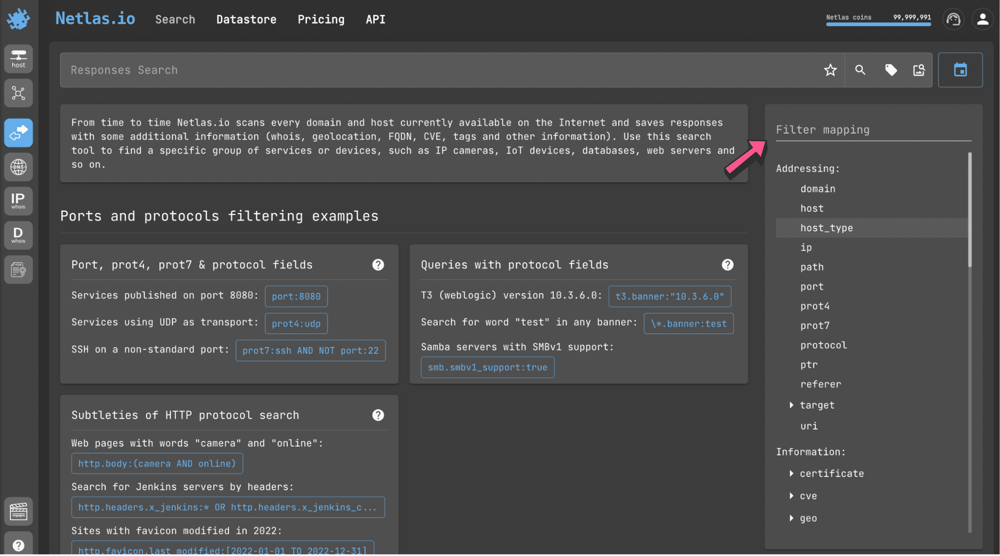

Filters allow you to search for servers based on parameters such as these.

* `host`, `ip`, `protocol`, and `geo.city` in Responses
* `domain` in DNS and Domain WHOIS
* Certificate, CVE, and contact fields where your plan supports them

[Netlas Search Tools](https://docs.netlas.io/quick-start/search-tools/#mapping)

### Logical Operators

You can use multiple filters in a single query and combine them using logical operators `AND`, `OR`, `NOT`. Use uppercase operators. Adjacent conditions use `AND` by default.

```text
http.title:netlas AND NOT port:443
```

[Try in Netlas](https://app.netlas.io/responses/?q=http.title%3Anetlas%20AND%20NOT%20port%3A443)

If you want to combine multiple conditions in your query, use parentheses.

```text
http.title:(netlas OR shodan) AND NOT port:443
```

[Try in Netlas](https://app.netlas.io/responses/?q=http.title%3A%28netlas%20OR%20shodan%29%20AND%20NOT%20port%3A443)

### Ranges

For numeric, date, and IP fields, use square brackets for a range that includes both endpoints.

```text
ip:[173.194.222.0 TO 173.194.222.255]
```

[Try in Netlas](https://app.netlas.io/responses/?q=ip%3A%5B173.194.222.0%20TO%20173.194.222.255%5D)

You can also specify only the upper or lower limit.

```text
host:1.1.1.1 AND port:<=1000
```

[Try in Netlas](https://app.netlas.io/responses/?q=host%3A1.1.1.1%20AND%20port%3A%3C%3D1000)

### Wildcards

In DNS search, use an asterisk when part of the domain is unknown.

```text
domain:google.*
```

[Try in Netlas](https://app.netlas.io/domains/?q=domain%3Agoogle.%2A)

You can also use a question mark.

```text
domain:google.??
```

[Try in Netlas](https://app.netlas.io/domains/?q=domain%3Agoogle.%3F%3F)

`*` matches zero or more characters and `?` matches one character.

You can also use an escaped asterisk in a field name.

```text
\*.banner:database
```

This query searches banner fields for multiple protocols. Keep wildcard patterns unquoted.

### Fuzziness

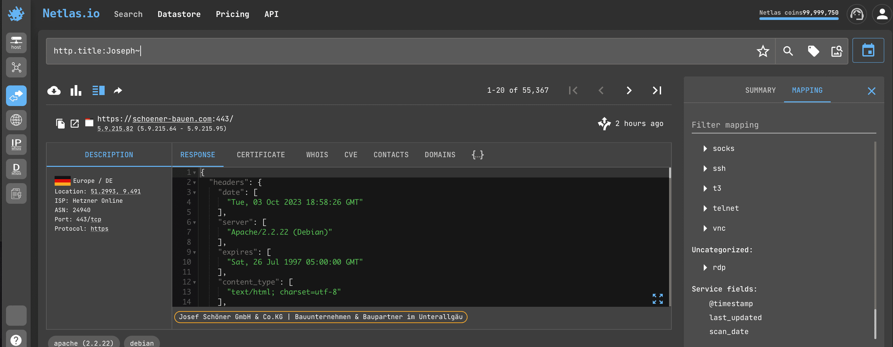

Use `~` to find terms within an edit distance of the supplied spelling. Netlas supports `~1` and `~2` and defaults to a distance of two when the number is omitted.

```text
http.title:joseph~1
```

[Try in Netlas](https://app.netlas.io/responses/?q=http.title%3Ajoseph~1) · [Fuzzy search](https://docs.netlas.io/knowledge-base/query-language/#fuzzy-search)

### Regular Expressions

Regular expression is a sequence of characters that allows you to search for, retrieve and replace pieces of text in a source document that match certain patterns.

Wrap a Lucene regular expression in forward slashes. In Responses Search, this pattern matches `www.example.com` or `www.example.net`.

```text
host:/www\.example\.(com|net)/
```

On a whole-value field such as `host`, the pattern must match the entire value. On a text field such as `http.title`, the pattern matches indexed terms. Lucene regex does not support anchors such as `^` and `$`. [Netlas regex reference](https://docs.netlas.io/knowledge-base/query-language/#regex)

### Other Netlas.io Search Features

#### Download Results <!-- omit in toc -->

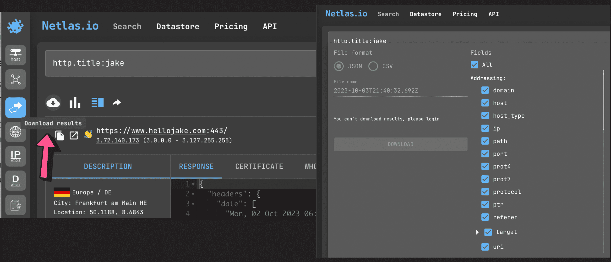

You can save your results (all or selected fields) in JSON and CSV format to view them in a format you like or automatically analyse them with different tools.

Your plan determines the export limit.

#### Group Results <!-- omit in toc -->

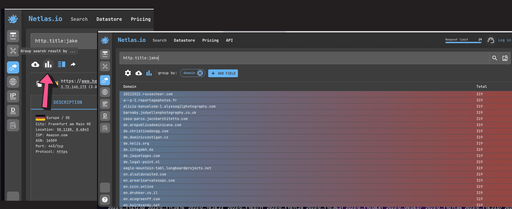

Use facet analysis to group matching documents by an available field such as `port` and compare the counts. [Facet analysis](https://docs.netlas.io/quick-start/search-tools/#facet-analysis)

#### Share Results <!-- omit in toc -->

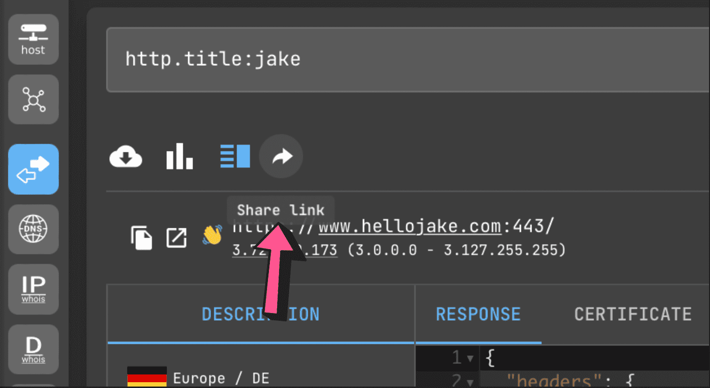

The Share control generates a short link and QR code for the current query. What the recipient can see depends on their account access and available indices. [Download and share](https://docs.netlas.io/quick-start/search-tools/#download-and-share)

<a id="search-history"></a>

#### Saved Searches <!-- omit in toc -->

Use Add to favorites beside the search bar to save a query you plan to run again. [Favorites](https://docs.netlas.io/quick-start/search-tools/#favorites)

## API Requests

Netlas.io's most important function is to help people conduct cybersecurity research faster and more efficiently. The service has an API (application programming interface) that allows you to automate the execution of various requests.

It can be implemented both in simple Python or Bash scripts of a few lines in length and in complex multifunctional applications.

The Netlas HTTP API is available at `https://app.netlas.io`. The API reference includes request examples and downloadable OpenAPI specifications. [Netlas API reference](https://docs.netlas.io/api-reference/)

### How to Find the API-key?

Get your personal API key from your Netlas profile and export it in the terminal where you will run the examples. For direct HTTP requests, pass the key as a bearer token in the `Authorization` header. [Netlas profile](https://app.netlas.io/profile/) · [API authentication](https://docs.netlas.io/api-reference/#authentication)

```bash
export NETLAS_API_KEY='YOUR_API_KEY'
```

### Tools for Debugging API Requests

You don't have to write scripts or create applications to start using the Netlas API. You can simply test it using your favorite API client. See [instructions here](https://docs.netlas.io/api-reference/).

### Structure of Netlas API JSON Response

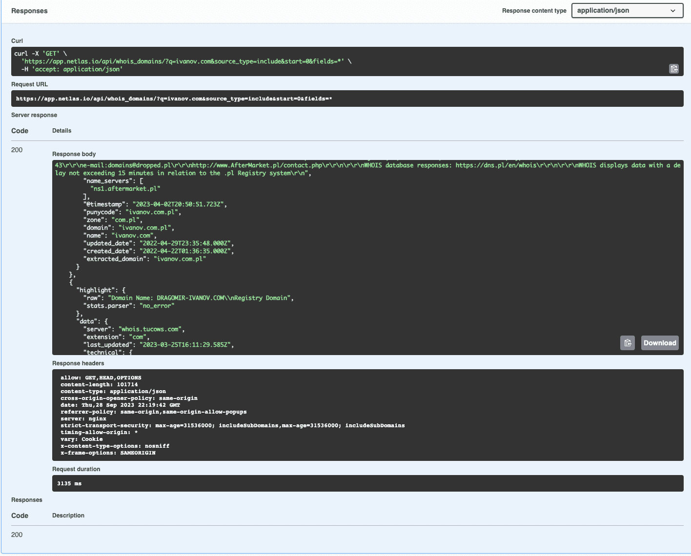

An HTTP search response has a status, headers, and a JSON body. A successful search puts its documents in an `items` array, with each document's fields under `data`. An empty `items` array means the query returned no documents. Other operations, such as Count and Host Summary, have their own response structures. [Netlas API reference](https://docs.netlas.io/api-reference/)

If you use Swagger, you can copy or download the response body and view it in any text editor or JSON analyser.

### Tools for Working with Data in JSON Format

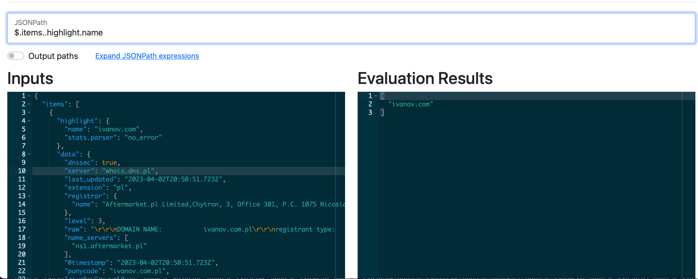

A little tip that will come in handy when writing code using the Netlas API. To understand the structure of a JSON file faster and find the path to a value, use a JSON viewer.

To inspect a saved search response locally, run `python3 -m json.tool results.json` or use the [jq utility](#jq-utility).

### Netlas Python Library

The easiest way to automate requests to the Netlas API is to use a specially designed Python library (package).

[Netlas-Python library Github repo](https://github.com/netlas-io/netlas-python)

Let's see how it works with a simple example. All code samples from Netlas Cookbook are located in the **scripts** folder. Clone this repository and install the SDK to run them on your device.

```bash
git clone https://github.com/netlas-io/netlas-cookbook.git
cd netlas-cookbook
python3 -m venv .venv
source .venv/bin/activate
python -m pip install netlas
netlas --help
```

Run `python scripts/netlas_python_example.py` with `NETLAS_API_KEY` set. Here is the code of the first example.

```python
import os

import netlas

api_key = os.environ.get("NETLAS_API_KEY")
if not api_key:
    raise SystemExit("Set NETLAS_API_KEY to your Netlas API key.")

connection = netlas.Netlas(api_key=api_key)
results = connection.search(query="host:netlas.io")

for item in results["items"]:
    uri = item.get("data", {}).get("uri")
    if uri:
        print(uri)
```

### Examples of Response Keys for Getting Useful Data

These are examples of fields inside a Responses search item's `data` object. Fields vary by protocol, plan, and document. The field mapping shows paths used in search queries. In returned JSON, some intermediate values can be arrays, such as `cve`.

| Data | Example paths inside `data` |
| --- | --- |
| Network and service | `uri`, `ip`, `host`, `port`, `protocol` |
| HTTP | `http.title`, `http.meta`, `http.body`, `http.status_code`, `http.favicon.path` |
| Approximate IP location | `geo.continent`, `geo.country`, `geo.city`, `geo.location` |
| IP WHOIS | `whois.net.country`, `whois.net.address`, `whois.net.contacts.emails` |
| CVE metadata | `cve.name`, `cve.description`, `cve.base_score` |

Read each item's `data` key and account for missing fields before traversing nested objects. [Responses field reference](https://docs.netlas.io/knowledge-base/field-reference/responses/)

### Netlas Python Response Datatypes

When working with the Netlas Python Library, it is very important to correctly specify the type of data you want to retrieve. By default, the `response` type is returned and many Netlas CookBook examples use it.

| SDK and CLI datatype | Collection |
| --- | --- |
| `response` | [Responses](https://app.netlas.io/responses/) |
| `domain` | [DNS](https://app.netlas.io/domains/) |
| `whois-domain` | [Domain WHOIS](https://app.netlas.io/whois_domains/) |
| `whois-ip` | [IP WHOIS](https://app.netlas.io/whois_ip/) |
| `cert` | [Certificates](https://app.netlas.io/certs/) |

For example, using the SDK connection from above, query `domain` in the DNS collection.

```python
results = connection.search(query="domain:netlas.io", datatype="domain")
```

### Netlas CLI Tools

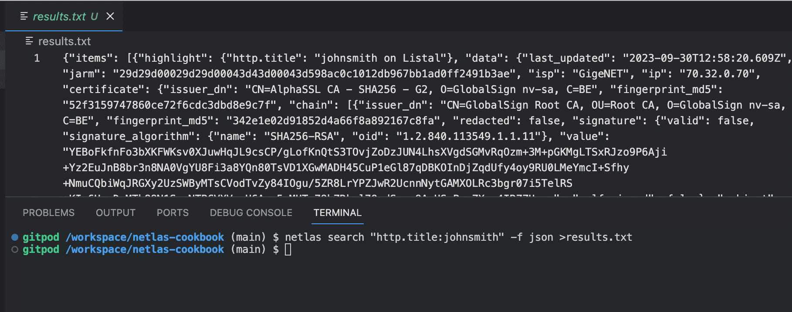

You can also use the Netlas Python Library directly from the command line.

Use `netlas --help` to list commands and `netlas search --help` to see search options. To save your key locally and write one page of Responses results as JSON, run the following commands. [Netlas CLI usage](https://github.com/netlas-io/netlas-python#cli-usage)

```bash
netlas savekey "$NETLAS_API_KEY"
netlas search 'host:netlas.io' --format json > results.json
```

### Search vs Download vs Host Methods

The Netlas API has many methods, but the most commonly used methods are search and download. They are very similar to each other, but still have some differences.

- **Search** returns up to 20 results per request. The API supports offsets up to 9,980, and your subscription can cap the number of available pages below the API maximum.
- **Download** retrieves a larger batch without paging through Search. Download size and account usage limits still apply.
- **Host Summary** returns the latest available summary for one IP address or domain. For example, run `netlas host netlas.io` after configuring the CLI.

[Netlas API reference](https://docs.netlas.io/api-reference/) · [Plan comparison](https://netlas.io/pricing/)

### Additional Request Parameters

The Netlas API allows you to flexibly adjust the data returned by requests with additional parameters.

- `start` is the zero-based REST result offset. Request `start=20` for the second page. The SDK uses a zero-based `page` argument instead.
- `indices` is one index label or a comma-separated string of labels. Use `netlas indices` or the Get Indices API endpoint to find available labels. Omitting `indices` uses the endpoint's default selection.
- `fields` limits which document fields come back. Use it with `source_type=include` or `source_type=exclude`.

[Netlas API reference](https://docs.netlas.io/api-reference/)

### Make Requests with Python (without Netlas Python Library)

Install the `requests` package with `python -m pip install requests` and run `python scripts/python_example.py`. This example prints the decoded DNS Search response. [Source script](scripts/python_example.py)

```python
import os

import requests

api_key = os.environ.get("NETLAS_API_KEY")
if not api_key:
    raise SystemExit("Set NETLAS_API_KEY to your Netlas API key.")

response = requests.get(
    "https://app.netlas.io/api/domains/",
    params={"q": "domain:netlas.io"},
    headers={"Authorization": f"Bearer {api_key}"},
    timeout=30,
)
response.raise_for_status()

print(response.json())
```

### Examples for Other Programming Languages

While we recommend using our Python Library to automate Netlas search, it's worth noting that the Netlas API can be built into most applications with a wide variety of technology stacks. The main thing is that it should be able to make **REST requests** and **parse JSON** data.

Here are some examples in different popular programming languages.

#### NodeJS <!-- omit in toc -->

Run `node scripts/nodejs_example.js` with a Node.js release that supports built-in `fetch` and `AbortSignal.timeout`. [Source script](scripts/nodejs_example.js) · [Node.js global APIs](https://nodejs.org/api/globals.html)

```javascript
const apiKey = process.env.NETLAS_API_KEY;
if (!apiKey) {
    console.error('Set NETLAS_API_KEY to your Netlas API key.');
    process.exit(1);
}

const url = new URL('https://app.netlas.io/api/domains/');
url.searchParams.set('q', 'domain:netlas.io');

fetch(url, {
    headers: { Authorization: `Bearer ${apiKey}` },
    signal: AbortSignal.timeout(30_000),
})
    .then((response) => {
        if (!response.ok) {
            throw new Error(`Netlas returned HTTP ${response.status}`);
        }
        return response.json();
    })
    .then((body) => console.log(body.items[0] ?? 'No results.'))
    .catch((error) => {
        console.error(error.message);
        process.exitCode = 1;
    });
```

#### Ruby <!-- omit in toc -->

Run `ruby scripts/ruby_example.rb`. [Source script](scripts/ruby_example.rb)

```ruby
require 'net/http'
require 'uri'
require 'json'

api_key = ENV['NETLAS_API_KEY']
abort 'Set NETLAS_API_KEY to your Netlas API key.' if api_key.nil? || api_key.empty?

uri = URI('https://app.netlas.io/api/domains/')
uri.query = URI.encode_www_form(q: 'domain:netlas.io')
request = Net::HTTP::Get.new(uri)
request['Authorization'] = "Bearer #{api_key}"

response = Net::HTTP.start(uri.hostname, uri.port, use_ssl: true, open_timeout: 30, read_timeout: 30) do |http|
  http.request(request)
end
abort "Netlas returned HTTP #{response.code}" unless response.is_a?(Net::HTTPSuccess)

result = JSON.parse(response.body)
puts result.dig('items', 0, 'data', 'domain') || 'No results.'
```

#### Bash <!-- omit in toc -->

Install `curl` and `jq`, then run `bash scripts/bash_example.sh`. [Source script](scripts/bash_example.sh)

```bash
#!/usr/bin/env bash
set -euo pipefail

: "${NETLAS_API_KEY:?Set NETLAS_API_KEY to your Netlas API key}"

curl --fail --silent --show-error --max-time 30 --get \
  'https://app.netlas.io/api/domains/' \
  --data-urlencode 'q=domain:netlas.io' \
  -H 'Accept: application/json' \
  -H "Authorization: Bearer $NETLAS_API_KEY" |
  jq -r '.items[0].data."@timestamp" // empty'
```

### JQ Utility

Note that in the example above, the JQ utility was used to extract fields from JSON data.

It is sometimes referred to as "like sed for JSON data".  It is a surprisingly handy tool for working with any JSON data.

Use `jq` to inspect and extract fields from a saved Search response such as `results.json`. When piping a request to `jq` in Bash, use `set -o pipefail` so a failed `curl` request sets a nonzero exit status for the pipeline.

```bash
jq '.items[0]' results.json
jq '.items[]' results.json
jq '.items[0].data' results.json
jq -r '.items[] | .data.uri // empty' results.json
```

The last command prints available URIs from a Responses search. [jq manual](https://jqlang.org/manual/)

### AI Tools for Writing Code

If you encounter any problems when customising the Netlas Cookbook examples, you can ask an AI tool to explain an error or suggest a change. Describe what you want the script to do and use sample data with the API key replaced by a placeholder. Check the suggested code against the Netlas documentation before running it.

[ChatGPT](https://chatgpt.com)  
[Code Llama](https://huggingface.co/spaces/codellama/codellama-playground)

### Code Checkers

If you run into errors while adapting the examples, use a syntax checker before testing against the API.

Run `python3 -m py_compile path/to/script.py` locally to catch Python syntax errors. To catch runtime and response-shape errors, also run the script with a small query and check both matching and empty responses. [Python py_compile documentation](https://docs.python.org/3/library/py_compile.html)

## Using Netlas.io for OSINT (Open Source Intelligence)

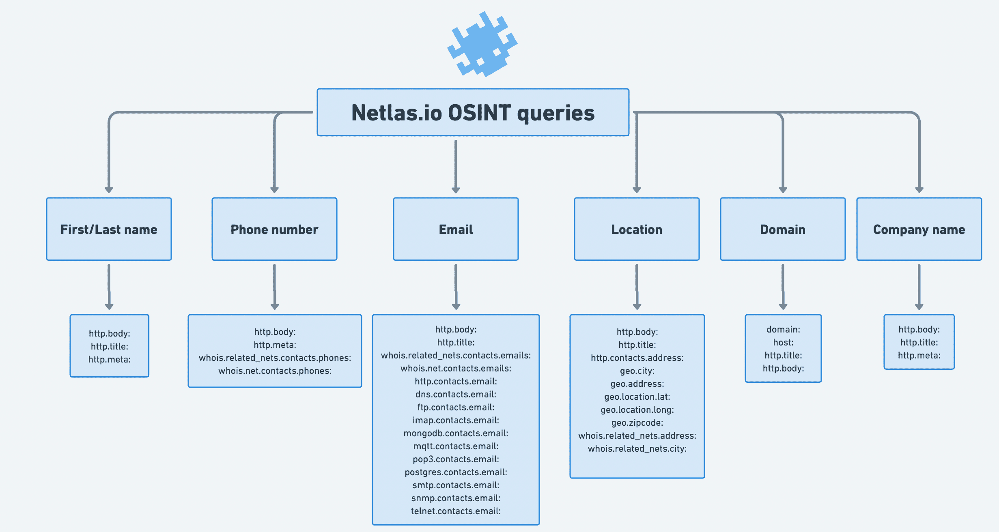

Netlas.io can help you gather data about a domain or company, as well as find mentions in indexed pages. It can also help you inspect historical HTTP responses.

Set `NETLAS_API_KEY` for the API and Python examples. The CLI uses the key configured with `netlas savekey`. Each search returns the first page by default.

<a id="search-persons-nickname-or-email-in-whois-contacts"></a>

### Search IP WHOIS Contact Emails

The Responses field `whois.related_nets.contacts.emails` searches contact emails from IP network registration records associated with a response. Use the separate [Domain WHOIS collection](#domain-whois-information-gathering) for domain registration contacts. The example uses a reserved domain and may return no results. [IANA example domains](https://www.iana.org/help/example-domains)

**Search query example**

```
whois.related_nets.contacts.emails:"hostmaster@example.com"
```

[Try in Netlas](https://app.netlas.io/responses/?q=whois.related_nets.contacts.emails%3A%22hostmaster%40example.com%22)

**API request example**

Netlas CLI Tools.

```bash
netlas search --format json 'whois.related_nets.contacts.emails:"hostmaster@example.com"'
```

Curl.

```bash
curl --fail-with-body -sS --get 'https://app.netlas.io/api/responses/' \
  -H "Authorization: Bearer ${NETLAS_API_KEY}" \
  --data-urlencode 'q=whois.related_nets.contacts.emails:"hostmaster@example.com"' | jq '.items[].data.uri'
```

**Code example (Netlas Python Library)**

Run in the command line.

```bash
python scripts/osint/whois_email_search.py
```

Source code of [scripts/osint/whois_email_search.py](scripts/osint/whois_email_search.py).

```python
import os

import netlas

netlas_connection = netlas.Netlas(api_key=os.environ["NETLAS_API_KEY"])
results = netlas_connection.search('whois.related_nets.contacts.emails:"hostmaster@example.com"')

for item in results.get("items", []):
    data = item["data"]
    print(data["uri"])
    print((data.get("geo") or {}).get("country"))
    print((data.get("whois") or {}).get("related_nets", []))
```

### Search for Person's Nickname or Email in Title and Body of Web Page

Netlas allows you to search for mentions of certain words in headings and in the HTML body of web pages. You can look for a phrase in quotes, use [fuzziness](#fuzziness) for approximate matches, or use [wildcards](#wildcards) when you are unsure about some characters.

**Search query example**

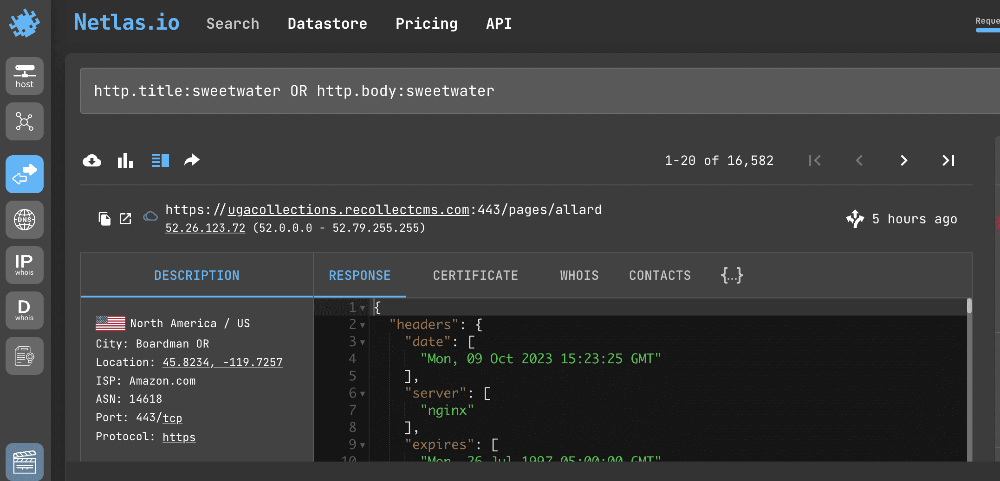

```
http.title:sweetwater OR http.body:sweetwater
```

[Try in Netlas](https://app.netlas.io/responses/?q=http.title%3Asweetwater+OR+http.body%3Asweetwater)

**API request example**

Netlas CLI Tools.

```bash
netlas search --format json 'http.title:sweetwater OR http.body:sweetwater'
```

Curl.

```bash
curl --fail-with-body -sS --get 'https://app.netlas.io/api/responses/' \
  -H "Authorization: Bearer ${NETLAS_API_KEY}" \
  --data-urlencode 'q=http.title:sweetwater OR http.body:sweetwater' | jq '.items[].data.uri'
```

**Code example (Netlas Python Library)**

Run in the command line.

```bash
python scripts/osint/title_body_search.py
```

Source code of [scripts/osint/title_body_search.py](scripts/osint/title_body_search.py).

```python
import os

import netlas

netlas_connection = netlas.Netlas(api_key=os.environ["NETLAS_API_KEY"])
results = netlas_connection.search('http.title:sweetwater OR http.body:sweetwater')

for item in results.get("items", []):
    data = item["data"]
    print(data["ip"])
    print(data["uri"])
    print((data.get("http") or {}).get("title"))
```

<a id="search-for-juicy-info-files-on-subdomains-of-the-companys-website"></a>

### Search Your Site for Public Document Mentions

Replace `example.com` with a domain you manage. This search finds indexed HTTP responses that mention PDF files on the domain or one of its subdomains. Inspect the page for links and verify the destination before treating a match as a document. Netlas indexes service responses, including the HTTP index page. [Netlas file search FAQ](https://docs.netlas.io/faq/#file-search)

**Search query example**

```
host:(example.com OR *.example.com) AND http.body:pdf
```

[Try in Netlas](https://app.netlas.io/responses/?q=host%3A%28example.com+OR+%2A.example.com%29+AND+http.body%3Apdf)

**API request example**

Netlas CLI Tools.

```bash
netlas search --format json 'host:(example.com OR *.example.com) AND http.body:pdf'
```

Curl.

```bash
curl --fail-with-body -sS --get 'https://app.netlas.io/api/responses/' \
  -H "Authorization: Bearer ${NETLAS_API_KEY}" \
  --data-urlencode 'q=host:(example.com OR *.example.com) AND http.body:pdf' | jq '.items[].data.uri'
```

**Code example (Netlas Python Library)**

Run in the command line.

```bash
python scripts/osint/juicyinfo_search.py
```

Source code of [scripts/osint/juicyinfo_search.py](scripts/osint/juicyinfo_search.py).

```python
import os

import netlas

netlas_connection = netlas.Netlas(api_key=os.environ["NETLAS_API_KEY"])
results = netlas_connection.search('host:(example.com OR *.example.com) AND http.body:pdf')

for item in results.get("items", []):
    data = item["data"]
    print(data["uri"])
    print((data.get("http") or {}).get("body", ""))
```

### Phone Number Mentions Search

We single out this task as a separate example, because phone numbers can be written in different formats.

Search for compact and separated forms of a published business phone number. `http.body` is tokenized, and `?` matches one character within a term. Use the field `whois.related_nets.contacts.phones` for IP WHOIS telephone contacts or `contacts.tel` for extracted response contacts where your plan allows access. This example uses a fictional number. [Netlas query language](https://docs.netlas.io/knowledge-base/query-language/#text-fields) · [NANPA reserved 555 numbers](https://nanpa.com/numbering/555-line-numbers)

**Search query example**

```
http.body:(2025550142 OR "202 555 0142")
```

[Try in Netlas](https://app.netlas.io/responses/?q=http.body%3A%282025550142+OR+%22202+555+0142%22%29)

**API request example**

Netlas CLI Tools.

```bash
netlas search --format json 'http.body:(2025550142 OR "202 555 0142")'
```

Curl.

```bash
curl --fail-with-body -sS --get 'https://app.netlas.io/api/responses/' \
  -H "Authorization: Bearer ${NETLAS_API_KEY}" \
  --data-urlencode 'q=http.body:(2025550142 OR "202 555 0142")' | jq '.items[].data.uri'
```

**Code example (Netlas Python Library)**

Run in the command line.

```bash
python scripts/osint/phonenumber_search.py
```

Source code of [scripts/osint/phonenumber_search.py](scripts/osint/phonenumber_search.py).

```python
import os

import netlas

netlas_connection = netlas.Netlas(api_key=os.environ["NETLAS_API_KEY"])
results = netlas_connection.search('http.body:(2025550142 OR "202 555 0142")')

for item in results.get("items", []):
    data = item["data"]
    print(data["ip"])
    print(data["uri"])
```

### Search File Mentions (Looking for Content That May be Infringing on Copyrights)

Let’s imagine that you are a musician and you want to find sites where your tracks may have been posted. Search for pages that mention both an artist name and an MP3 reference.

The tokenized body search can find plain-text mentions and miss some links. Inspect the matching page to see where the file reference leads.

**Search query example**

```
(http.title:alla OR http.body:alla) AND http.body:mp3
```

[Try in Netlas](https://app.netlas.io/responses/?q=%28http.title%3Aalla+OR+http.body%3Aalla%29+AND+http.body%3Amp3)

**API request example**

Netlas CLI Tools.

```bash
netlas search --format json '(http.title:alla OR http.body:alla) AND http.body:mp3'
```

Curl.

```bash
curl --fail-with-body -sS --get 'https://app.netlas.io/api/responses/' \
  -H "Authorization: Bearer ${NETLAS_API_KEY}" \
  --data-urlencode 'q=(http.title:alla OR http.body:alla) AND http.body:mp3' | jq '.items[].data.http.title'
```

**Code example (Netlas Python Library)**

Run in the command line.

```bash
python scripts/osint/file_mentions_search.py
```

Source code of [scripts/osint/file_mentions_search.py](scripts/osint/file_mentions_search.py).

```python
import os

import netlas

netlas_connection = netlas.Netlas(api_key=os.environ["NETLAS_API_KEY"])
results = netlas_connection.search('(http.title:alla OR http.body:alla) AND http.body:mp3')

for item in results.get("items", []):
    data = item["data"]
    print(data["ip"])
    print(data["uri"])
    print((data.get("http") or {}).get("title"))
```

### Domain WHOIS Information Gathering

The Netlas Domain WHOIS collection contains indexed domain registration records. The fields available depend on the source, applicable redactions, and the plan. For a current gTLD registration lookup directly from registries and registrars, use ICANN's RDAP-based Lookup service. [ICANN RDAP overview](https://www.icann.org/en/contracted-parties/registry-operators/resources/registration-data-access-protocol) · [ICANN Lookup](https://lookup.icann.org/en)

**Search query example**

```
domain:github.com
```

[Try in Netlas](https://app.netlas.io/whois_domains/?q=domain%3Agithub.com)

**API request example**

Netlas CLI Tools.

```bash
netlas search --datatype whois-domain --format json 'domain:github.com'
```

Curl.

```bash
curl --fail-with-body -sS --get 'https://app.netlas.io/api/whois_domains/' \
  -H "Authorization: Bearer ${NETLAS_API_KEY}" \
  --data-urlencode 'q=domain:github.com' | jq '.items[].data | {domain, organization: .registrant.organization}'
```

**Code example (Netlas Python Library)**

Run in the command line.

```bash
python scripts/osint/whois_search.py
```

Source code of [scripts/osint/whois_search.py](scripts/osint/whois_search.py).

```python
import os

import netlas

netlas_connection = netlas.Netlas(api_key=os.environ["NETLAS_API_KEY"])
results = netlas_connection.search('domain:github.com', datatype='whois-domain')

for item in results.get("items", []):
    data = item["data"]
    print(data["domain"])
    print((data.get("registrant") or {}).get("organization"))
```

<a id="search-location-in-address-tag"></a>

### Search Extracted Contact Addresses

The HTML `<address>` element can contain contact information for a document or article. In Netlas, `contacts.address` contains physical addresses extracted from different parts of service responses, including web pages. Filter by `prot7:http` to include HTTP and HTTPS results. Use `contacts.email` to search extracted email addresses. [HTML standard](https://html.spec.whatwg.org/multipage/sections.html#the-address-element) · [Responses field reference](https://docs.netlas.io/knowledge-base/field-reference/responses/#contacts-address)

**Search query example**

```
prot7:http AND host:(example.com OR *.example.com) AND contacts.address:*
```

[Try in Netlas](https://app.netlas.io/responses/?q=prot7%3Ahttp+AND+host%3A%28example.com+OR+%2A.example.com%29+AND+contacts.address%3A%2A)

**API request example**

Netlas CLI Tools.

```bash
netlas search --format json 'prot7:http AND host:(example.com OR *.example.com) AND contacts.address:*'
```

Curl.

```bash
curl --fail-with-body -sS --get 'https://app.netlas.io/api/responses/' \
  -H "Authorization: Bearer ${NETLAS_API_KEY}" \
  --data-urlencode 'q=prot7:http AND host:(example.com OR *.example.com) AND contacts.address:*' | jq '.items[].data.contacts.address'
```

**Code example (Netlas Python Library)**

Run in the command line.

```bash
python scripts/osint/contacts_search.py
```

Source code of [scripts/osint/contacts_search.py](scripts/osint/contacts_search.py).

```python
import os

import netlas

netlas_connection = netlas.Netlas(api_key=os.environ["NETLAS_API_KEY"])
results = netlas_connection.search('prot7:http AND host:(example.com OR *.example.com) AND contacts.address:*')

for item in results.get("items", []):
    data = item["data"]
    print(data["uri"])
    print((data.get("contacts") or {}).get("address"))
```

### Search Author Name in Meta Tags

`<meta>` tags are located inside the `<head>` of a web page and may contain keywords, a description, service information, and the author’s name.

The `http.meta` field searches metadata extracted from HTML `<meta>` elements. This query matches the term in any indexed meta content. Inspect the original response to see whether it appears in `<meta name="author">`.

**Search query example**

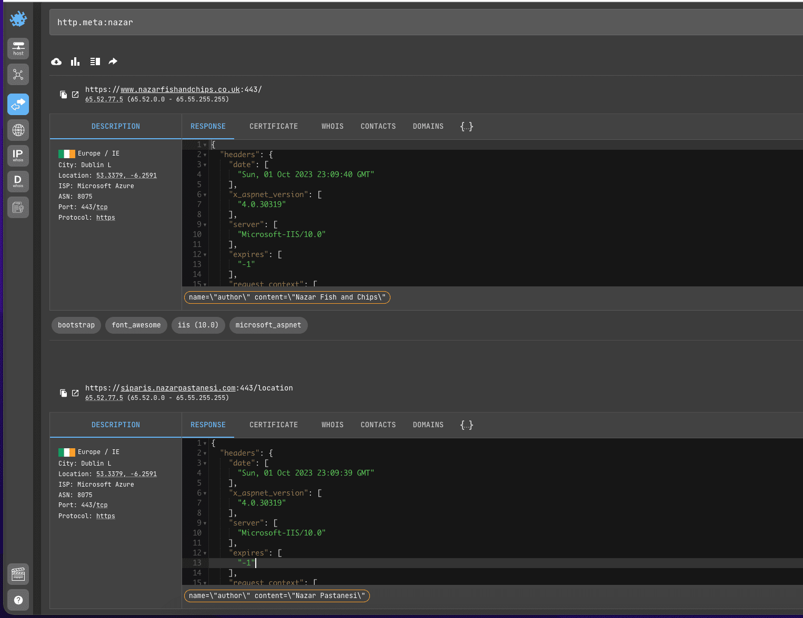

```
http.meta:nazar
```

[Try in Netlas](https://app.netlas.io/responses/?q=http.meta%3Anazar)

**API request example**

Netlas CLI Tools.

```bash
netlas search --format json 'http.meta:nazar'
```

Curl.

```bash
curl --fail-with-body -sS --get 'https://app.netlas.io/api/responses/' \
  -H "Authorization: Bearer ${NETLAS_API_KEY}" \
  --data-urlencode 'q=http.meta:nazar' | jq '.items[].data.http.meta'
```

**Code example (Netlas Python Library)**

Run in the command line.

```bash
python scripts/osint/author_meta_search.py
```

Source code of [scripts/osint/author_meta_search.py](scripts/osint/author_meta_search.py).

```python
import os

import netlas

netlas_connection = netlas.Netlas(api_key=os.environ["NETLAS_API_KEY"])
results = netlas_connection.search('http.meta:nazar')

for item in results.get("items", []):
    data = item["data"]
    print(data["uri"])
    http = data.get("http") or {}
    print(http.get("title"))
    print(http.get("meta"))
```

### What Other Interesting Things Can Be Found in the Meta Tags of HTML Document?

In addition to the author’s name, HTML metadata can contain information about a document’s encoding, summaries, and social sharing previews. Here are some examples.

*  `<meta name="description">` - description of web page content.
*  `<meta name="keywords">`  - keywords that describe the content of the web page.
*  `<meta name="generator">`  - name of the tool that was used to generate the page content (useful for searching CMS and hosting platforms)

HTML documents can include `<meta name="description">` for a page summary, `<meta name="keywords">` for descriptive keywords, and `<meta name="generator">` for the software that generated the page. The `charset` attribute declares the encoding, and the `lang` attribute on the HTML element declares the language of the document. [HTML standard](https://html.spec.whatwg.org/multipage/semantics.html#standard-metadata-names)

### Search by FTP Server's Banners Text

A banner can identify a service or contain a term associated with its operator. This example looks for Pure-FTPd in the recorded FTP banner. Use `prot7:ftp` to filter by application protocol when combining FTP with other filters.

**Search query example**

```
ftp.banner:"pure-ftpd"
```

[Try in Netlas](https://app.netlas.io/responses/?q=ftp.banner%3A%22pure-ftpd%22)

**API request example**

Netlas CLI Tools.

```bash
netlas search --format json 'ftp.banner:"pure-ftpd"'
```

Curl.

```bash
curl --fail-with-body -sS --get 'https://app.netlas.io/api/responses/' \
  -H "Authorization: Bearer ${NETLAS_API_KEY}" \
  --data-urlencode 'q=ftp.banner:"pure-ftpd"' | jq '.items[].data.uri'
```

**Code example (Netlas Python Library)**

Run in the command line.

```bash
python scripts/osint/ftp_banner_search.py
```

Source code of [scripts/osint/ftp_banner_search.py](scripts/osint/ftp_banner_search.py).

```python
import os

import netlas

netlas_connection = netlas.Netlas(api_key=os.environ["NETLAS_API_KEY"])
results = netlas_connection.search('ftp.banner:"pure-ftpd"')

for item in results.get("items", []):
    data = item["data"]
    print(data["ip"])
    print(data["uri"])
    print((data.get("ftp") or {}).get("banner"))
```

<a id="search-for-contact-information-in-ssl-certificates"></a>

### Search for Contact Information in TLS Certificates

A TLS certificate can contain details about the subject and the issuer. Use `certificate.subject.*` for attributes of the certificate holder, and `certificate.issuer.*` for attributes of the issuing authority. Subject fields such as `organization`, `email_address`, or `street_address` are populated only when present in the certificate. This query matches responses whose leaf certificate includes a subject street address. [RFC 5280](https://www.rfc-editor.org/rfc/rfc5280#section-4.1.2.6) · [Responses field reference](https://docs.netlas.io/knowledge-base/field-reference/responses/#certificate)

**Search query example**

```
certificate.subject.street_address:*
```

[Try in Netlas](https://app.netlas.io/responses/?q=certificate.subject.street_address%3A%2A)

**API request example**

Netlas CLI Tools.

```bash
netlas search --format json 'certificate.subject.street_address:*'
```

Curl.

```bash
curl --fail-with-body -sS --get 'https://app.netlas.io/api/responses/' \
  -H "Authorization: Bearer ${NETLAS_API_KEY}" \
  --data-urlencode 'q=certificate.subject.street_address:*' | jq '.items[].data.certificate.subject'
```

**Code example (Netlas Python Library)**

Run in the command line.

```bash
python scripts/osint/certificates_search.py
```

Source code of [scripts/osint/certificates_search.py](scripts/osint/certificates_search.py).

```python
import os

import netlas

netlas_connection = netlas.Netlas(api_key=os.environ["NETLAS_API_KEY"])
results = netlas_connection.search('certificate.subject.street_address:*')

for item in results.get("items", []):
    data = item["data"]
    print(data["uri"])
    print((data.get("certificate") or {}).get("subject"))
```

<a id="using-netlas-as-an-alternative-to-the-wayback-machine"></a>

### Inspect Historical HTTP Responses

Archive.org has been used by OSINT specialists to search old versions of websites. Netlas can also provide a record of individual HTTP responses from earlier scans.

Netlas retains historical indices for its search tools. In Responses, select the calendar button next to the search bar and choose an available index. Use a query such as the following to find stored responses for a domain. [Historical data FAQ](https://docs.netlas.io/faq/#historical-data)

```
host:github.com
```

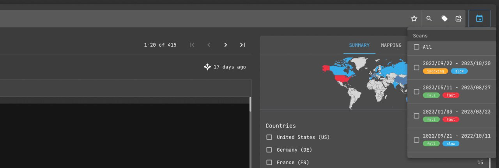

Open a result and inspect the `http.body` field in the response. Netlas stores up to the first 100 KB of each response and follows up to five HTTP redirects. Treat the capture as a record of the response at scan time. [Scanning technology](https://docs.netlas.io/knowledge-base/scanning-technology/#extended-http-support)

### 9 Ways to Search Related Websites

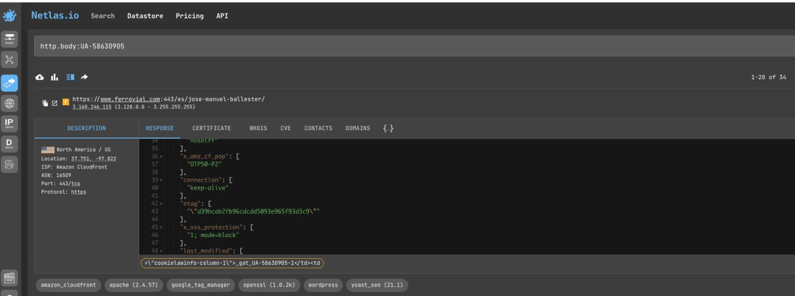

Use several independent signals before attributing sites to the same organization. Shared providers, integrations, templates, and identifiers can give unrelated sites matching values.

1. **Tracking identifiers.** Use the corresponding extracted field in Responses.

   ```
   http.tracker.google_analytics:"G-EM4LHS2YB5"
   http.tracker.google_tag_manager:"GTM-MQJS9PH"
   http.tracker.facebook_pixel:"1006261009491006"
   http.tracker.yandex_metrica:"38648545"
   ```

   These IDs were observed in Netlas responses. To find a fresh sample, run an existence query such as `http.tracker.google_analytics:*` and copy an ID from a matching response.

2. **Affiliate links.** Extract a public partner identifier from a link and search for its value in `http.body`. Verify the parameter name and value together in the response because the query is tokenized.

3. **Registrant organization.** Open Domain WHOIS and search the registration field.

   ```
   registrant.organization:"GitHub, Inc."
   ```

   [Try in Netlas](https://app.netlas.io/whois_domains/?q=registrant.organization%3A%22GitHub%2C%20Inc.%22)

4. **Mail servers.** Open DNS Search and search for domains listing an MX record.

   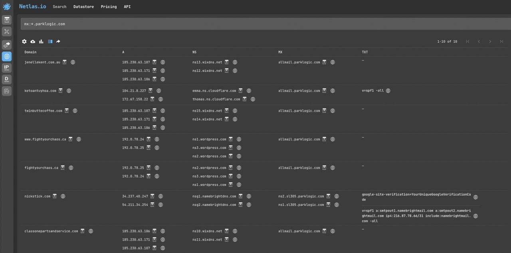

   ```
   mx:*.parklogic.com
   ```

   [Try in Netlas](https://app.netlas.io/domains/?q=mx%3A*.parklogic.com)

5. **Name servers.** Open DNS Search and search for domains listing an NS record.

   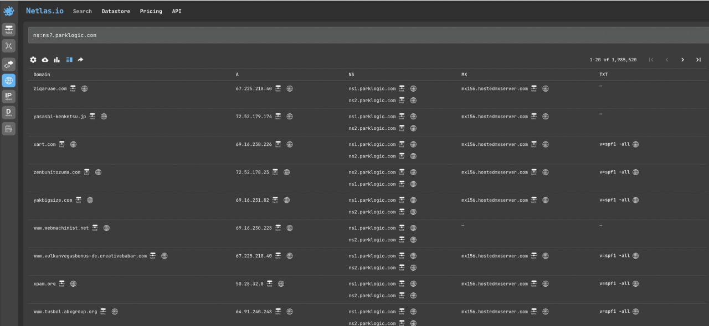

   ```
   ns:ns?.parklogic.com
   ```

   [Try in Netlas](https://app.netlas.io/domains/?q=ns%3Ans%3F.parklogic.com)

6. **File references.** Search for distinctive filenames or assets in page content. [Search MP3 Mentions](#search-file-mentions-looking-for-content-that-may-be-infringing-on-copyrights)

7. **Subdomains.** Search for hostnames under the same domain. [Subdomain Search](#subdomain-search)

8. **IP WHOIS contacts.** Look for a shared contact in the network registration records. [Search IP WHOIS Contact Emails](#search-ip-whois-contact-emails)

9. **Favicons.** Compare the bytes or visual appearance of site icons. [Favicon Search](#favicon-search)

## Scraping (Extract Data from Web Page Body)

Use `http.body` to parse the HTML recorded for an indexed response. Netlas requests the HTTP index page and stores up to the first 100 KB of each response. The recorded body may lack content loaded later by a browser. [Netlas scanning technology](https://docs.netlas.io/knowledge-base/scanning-technology/#http-body) · [Netlas file search FAQ](https://docs.netlas.io/faq/#file-search)

<a id="beatifulsoup-package"></a>

### Beautiful Soup Package

Use Beautiful Soup to extract `<h1>` headings from a captured page. Install the package with `python -m pip install beautifulsoup4`. [Beautiful Soup documentation](https://www.crummy.com/software/BeautifulSoup/bs4/doc/)

**Python SDK**

Run [`scraping_beatifulsoup.py`](scripts/osint/scraping_beatifulsoup.py) from the repository root.

```bash
python scripts/osint/scraping_beatifulsoup.py
```

```python
import os

import netlas
from bs4 import BeautifulSoup

netlas_connection = netlas.Netlas(api_key=os.environ["NETLAS_API_KEY"])
results = netlas_connection.search('host:example.com AND http.body:*')

for item in results.get("items", []):
    data = item["data"]
    print(data["uri"])
    body = (data.get("http") or {}).get("body") or ""
    soup = BeautifulSoup(body, "html.parser")
    for heading in soup.find_all("h1"):
        print(heading.get_text(" ", strip=True))
```

Use `soup.find(id="loginform")`, `soup.find(class_="forms")`, or `soup.find("a", href="https://example.com")` to select an element by an attribute. Check whether `find()` returned an element before calling `get_text()`. [Beautiful Soup search methods](https://www.crummy.com/software/BeautifulSoup/bs4/doc/#searching-the-tree)

If you want to find all elements of a certain type use the `find_all()` method.

### Re Package

The standard Python `re` module can extract email-like strings from a captured body. Replace `example.com` with a site you manage to check published contact details. The pattern identifies candidates for review. [Python regular expressions documentation](https://docs.python.org/3/library/re.html)

**Python SDK**

Run [`scraping_re.py`](scripts/osint/scraping_re.py) from the repository root.

```bash
python scripts/osint/scraping_re.py
```

```python
import os
import re

import netlas

netlas_connection = netlas.Netlas(api_key=os.environ["NETLAS_API_KEY"])
email_pattern = re.compile(r"[A-Za-z0-9._%+-]+@[A-Za-z0-9-]+(?:\.[A-Za-z0-9-]+)+")
results = netlas_connection.search('host:example.com AND http.body:*')

for item in results.get("items", []):
    data = item["data"]
    print(data["uri"])
    body = (data.get("http") or {}).get("body") or ""
    for email in email_pattern.findall(body):
        print(email)
```

### Other Python Packages for Scraping

Beautiful Soup and regular expressions are two ways to extract data from web pages. Here are some other Python packages.

* [Scrapy](https://pypi.org/project/Scrapy/): It is primarily a crawler (a tool for traversing website pages using links found on other pages) and, in addition, it has extensive capabilities for extracting data from web pages.
* [Selenium](https://pypi.org/project/selenium/): A tool for automating your browser experience. Allows you to extract data from content that is generated by JavaScript.
* [Lxml](https://pypi.org/project/lxml/): Tool for scraping and validating XML files.
* [PDFtoText](https://pypi.org/project/pdftotext/) - tool for extracting text content from PDF files.

## Using Netlas.io for Crypto Investigations

These examples use `example.com` and `192.0.2.0/24`, which are reserved for documentation. The example scope may return no matching records. For an inventory review, substitute the domains or network ranges you are authorized to assess. [IANA example domains](https://www.iana.org/help/example-domains) · [RFC 5737](https://datatracker.ietf.org/doc/html/rfc5737)

### Search Mining Farms

If a mining device in your inventory advertises its product name in the HTTP `WWW-Authenticate` header, you can search for that text. Use the value observed on your equipment. The header is a product-identification clue that can vary by model or firmware.

```text
ip:"192.0.2.0/24" AND http.headers.www_authenticate:antminer
```

Use the same query with the Netlas CLI or Responses API. The commands use the `NETLAS_API_KEY` environment variable configured in [API Requests](#api-requests). [Responses API reference](https://docs.netlas.io/api-reference/)

```bash
netlas search 'ip:"192.0.2.0/24" AND http.headers.www_authenticate:antminer' \
  -a "$NETLAS_API_KEY" -i uri,http.headers.www_authenticate -f json
```

```bash
curl --fail-with-body --silent --show-error --get 'https://app.netlas.io/api/responses/' \
  --header "Authorization: Bearer $NETLAS_API_KEY" \
  --data-urlencode 'q=ip:"192.0.2.0/24" AND http.headers.www_authenticate:antminer' \
  --data-urlencode 'fields=uri,http.headers.www_authenticate'
```

The Python example uses the Netlas SDK. [mining_farms_search.py](scripts/crypto/mining_farms_search.py)

Source code.

```python
import os

import netlas

api_key = os.getenv("NETLAS_API_KEY")
if not api_key:
    raise SystemExit("Set NETLAS_API_KEY to your Netlas API key.")

connection = netlas.Netlas(api_key=api_key)
query = 'ip:"192.0.2.0/24" AND http.headers.www_authenticate:antminer'
results = connection.search(query=query, fields="uri,http.headers.www_authenticate")

for item in results["items"]:
    data = item["data"]
    headers = ((data.get("http") or {}).get("headers") or {})
    print(data["uri"], headers.get("www_authenticate", ""), sep="\t")
```

<a id="search-for-websites-infected-with-cryptominers"></a>

### Search for Historical Cryptomining References

Coinhive stopped its mining service in March 2019. A match for its name in an archived or recent response could be a historical script reference or an ordinary text mention. Review the observed response and the asset's source code to determine what the reference means. [USENIX research on Coinhive's shutdown](https://www.usenix.org/system/files/sec19-bijmans.pdf)

```text
host:(example.com OR *.example.com) AND http.body:coinhive
```

The Python example prints matching response URIs. [search_sites_injected_with_miners.py](scripts/crypto/search_sites_injected_with_miners.py)

Source code.

```python
import os

import netlas

api_key = os.getenv("NETLAS_API_KEY")
if not api_key:
    raise SystemExit("Set NETLAS_API_KEY to your Netlas API key.")

connection = netlas.Netlas(api_key=api_key)
query = 'host:(example.com OR *.example.com) AND http.body:coinhive'
results = connection.search(query=query, fields="uri")

for item in results["items"]:
    print(item["data"]["uri"])
```

<a id="search-vulnerable-bitcoin-nodes"></a>

### Inventory Potential Bitcoin Nodes

Bitcoin mainnet peers listen on TCP port `8333` by default. A port match shows that Netlas recorded a service on that port. Verify the protocol or running software against your inventory. [Bitcoin P2P network reference](https://developer.bitcoin.org/reference/p2p_networking.html#constants-and-defaults)

```text
ip:"192.0.2.0/24" AND prot4:tcp AND port:8333
```

The Python example prints matching service URIs. [search_bitcoin_nodes.py](scripts/crypto/search_bitcoin_nodes.py)

Source code.

```python
import os

import netlas

api_key = os.getenv("NETLAS_API_KEY")
if not api_key:
    raise SystemExit("Set NETLAS_API_KEY to your Netlas API key.")

connection = netlas.Netlas(api_key=api_key)
query = 'ip:"192.0.2.0/24" AND prot4:tcp AND port:8333'
results = connection.search(query=query, fields="uri")

for item in results["items"]:
    print(item["data"]["uri"])
```

<a id="using-neltas-for-pentest"></a>

## Using Netlas for Pentest

Use the examples in this section to review domains or IP ranges you are authorized to assess. The examples use documentation ranges and may return zero matches.

CVE annotations associate detected software with published advisories. Netlas can match by product and version (`cve.match_type:cpe`) or by product family (`cve.match_type:product`). Check the installed version, vendor advisory, configuration, and patch status when triaging a result. Software detection and backported fixes can affect the accuracy of a match. [Netlas vulnerability detection](https://docs.netlas.io/knowledge-base/software-and-vulnerabilities/#how-netlas-links-vulnerabilities)

CVE and tag filter availability depends on your subscription. [Netlas plan FAQ](https://docs.netlas.io/faq/#freelancer-cve-search)

### Subdomain Search

In **Responses Search**, `host` is the IP address or domain used in the request that returned the indexed response. Use a wildcard to match subdomains. Include the apex explicitly if you also want it in the results. [Netlas query language](https://docs.netlas.io/knowledge-base/query-language/#fields-and-search-terms)

```text
host:*.example.com
```

For DNS records, use **DNS Search** and its `domain` field. Coverage depends on Netlas’s scans and DNS data sources. [Netlas search tools](https://docs.netlas.io/quick-start/search-tools/)

```text
domain:*.example.com
```

The Python example uses Responses Search. [subdomain_search.py](scripts/pentest/subdomain_search.py)

Source code.

```python
import os

import netlas

api_key = os.getenv("NETLAS_API_KEY")
if not api_key:
    raise SystemExit("Set NETLAS_API_KEY to your Netlas API key.")

connection = netlas.Netlas(api_key=api_key)
query = 'host:*.example.com'
results = connection.search(query=query, fields="ip,uri")

for item in results["items"]:
    data = item["data"]
    print(data["ip"], data["uri"], sep="\t")
```

### Search for Sites with Specific Vulnerabilities

On the documentation network, filter for an exact CVE identifier. This example uses the Spring Framework advisory CVE-2022-22965. Consult the vendor's advisory for affected versions and mitigations. [Spring advisory](https://spring.io/security/cve-2022-22965/)

```text
ip:"192.0.2.0/24" AND cve.name:"CVE-2022-22965"
```

The Python example prints the URI and match type for annotations with the requested CVE identifier. [cve_search.py](scripts/pentest/cve_search.py)

Source code.

```python
import os

import netlas

api_key = os.getenv("NETLAS_API_KEY")
if not api_key:
    raise SystemExit("Set NETLAS_API_KEY to your Netlas API key.")

connection = netlas.Netlas(api_key=api_key)
cve_id = "CVE-2022-22965"
query = f'ip:"192.0.2.0/24" AND cve.name:"{cve_id}"'
results = connection.search(query=query, fields="uri,cve.name,cve.match_type")

for item in results["items"]:
    data = item["data"]
    for annotation in data.get("cve") or []:
        if annotation.get("name") == cve_id:
            print(data["uri"], cve_id, annotation.get("match_type", ""), sep="\t")
```

### Search for Sites with Vulnerabilities That Contain a Certain Word in Their Descriptions

`cve.description` is a full-text field. A search for `spring` retrieves records with that term in a vulnerability description. The same response can also carry other CVE annotations. [Netlas query language](https://docs.netlas.io/knowledge-base/query-language/#text-fields)

```text
ip:"192.0.2.0/24" AND cve.description:spring
```

The Python example prints matching response URIs. [cve_description_search.py](scripts/pentest/cve_description_search.py)

Source code.

```python
import os

import netlas

api_key = os.getenv("NETLAS_API_KEY")
if not api_key:
    raise SystemExit("Set NETLAS_API_KEY to your Netlas API key.")

connection = netlas.Netlas(api_key=api_key)
query = 'ip:"192.0.2.0/24" AND cve.description:spring'
results = connection.search(query=query, fields="uri")

for item in results["items"]:
    print(item["data"]["uri"])
```

### Search by Server HTTP Header

The HTTP `Server` header can identify advertised web server or proxy software. Operators can change or omit it, and a proxy can differ from the application behind it. [HTTP semantics, Server header](https://www.rfc-editor.org/rfc/rfc9110.html#section-10.2.4)

```text
host:(example.com OR *.example.com) AND http.headers.server:nginx
```

The Python example prints the URI and observed header value. [server_name_search.py](scripts/pentest/server_name_search.py)

Source code.

```python
import os

import netlas

api_key = os.getenv("NETLAS_API_KEY")
if not api_key:
    raise SystemExit("Set NETLAS_API_KEY to your Netlas API key.")

connection = netlas.Netlas(api_key=api_key)
query = 'host:(example.com OR *.example.com) AND http.headers.server:nginx'
results = connection.search(query=query, fields="uri,http.headers.server")

for item in results["items"]:
    data = item["data"]
    headers = ((data.get("http") or {}).get("headers") or {})
    print(data["uri"], headers.get("server", ""), sep="\t")
```

<a id="search-for-vulnerable-servers-by-favicon-hash"></a>

### Match an Inventory Favicon by Hash

The `http.favicon.hash_sha256` field matches the exact bytes of a favicon. Different services can share a favicon, and the hash changes when the file bytes change. Netlas also supports perceptual hash searches when visual similarity is the goal. [Netlas favicon search](https://docs.netlas.io/knowledge-base/scanning-technology/#favicon-search)

```text
host:(example.com OR *.example.com) AND http.favicon.hash_sha256:41b986fa07a964750db98c7d4195812ea87da7f300b9dabb3f046c2dcd730728
```

The example digest represents placeholder bytes. Pass the path to a local icon to compute its digest and search within the example domain scope. [favicon_hash_search.py](scripts/pentest/favicon_hash_search.py)

```bash
python scripts/pentest/favicon_hash_search.py path/to/favicon.ico
```

Source code.

```python
import argparse
import hashlib
import os
from pathlib import Path

import netlas

parser = argparse.ArgumentParser(description="Search for an exact favicon match in the example domain scope.")
parser.add_argument("favicon", type=Path, help="Path to a local favicon file.")
args = parser.parse_args()

api_key = os.getenv("NETLAS_API_KEY")
if not api_key:
    raise SystemExit("Set NETLAS_API_KEY to your Netlas API key.")

try:
    digest = hashlib.sha256(args.favicon.read_bytes()).hexdigest()
except OSError as error:
    parser.error(str(error))

connection = netlas.Netlas(api_key=api_key)
query = f"host:(example.com OR *.example.com) AND http.favicon.hash_sha256:{digest}"
results = connection.search(query=query, fields="uri,http.title")

for item in results["items"]:
    data = item["data"]
    print(data["uri"], (data.get("http") or {}).get("title", ""), sep="\t")
```

<a id="search-for-vulnerable-servers-by-tag-name"></a>

### Search by Technology Tag

Netlas applies technology tags using signals such as HTTP headers, HTML, and protocol banners. Some rules also report a version. `tag.name` searches for a technology, and `tag.category` searches for a category. The **Search by Tag** button in Responses Search lists technologies. [Netlas technology detection](https://docs.netlas.io/knowledge-base/software-and-vulnerabilities/#technology-detection)

```text
host:(example.com OR *.example.com) AND tag.name:wordpress
```

The Python example prints matching response URIs. [search_tag_name.py](scripts/pentest/search_tag_name.py)

Source code.

```python
import os

import netlas

api_key = os.getenv("NETLAS_API_KEY")
if not api_key:
    raise SystemExit("Set NETLAS_API_KEY to your Netlas API key.")

connection = netlas.Netlas(api_key=api_key)
query = 'host:(example.com OR *.example.com) AND tag.name:wordpress'
results = connection.search(query=query, fields="uri")

for item in results["items"]:
    print(item["data"]["uri"])
```

<a id="search-for-vulnerable-servers-and-devices-near-you-or-any-other-location"></a>

### Filter CVE Annotations by IP Geolocation

You can restrict the results to a city within the network range under review. Geolocation describes the IP address and can differ from the asset's physical location. `geo.country` takes a two-letter country code.

```text
ip:"192.0.2.0/24" AND geo.city:London AND cve.name:*
```

The Python example prints the response URI, mapped city, and each available CVE identifier. [cve_location_search.py](scripts/pentest/cve_location_search.py)

Source code.

```python
import os

import netlas

api_key = os.getenv("NETLAS_API_KEY")
if not api_key:
    raise SystemExit("Set NETLAS_API_KEY to your Netlas API key.")

connection = netlas.Netlas(api_key=api_key)
query = 'ip:"192.0.2.0/24" AND geo.city:London AND cve.name:*'
results = connection.search(query=query, fields="uri,geo.city,cve.name")

for item in results["items"]:
    data = item["data"]
    city = (data.get("geo") or {}).get("city", "")
    for annotation in data.get("cve") or []:
        if annotation.get("name"):
            print(data["uri"], city, annotation["name"], sep="\t")
```

### Search for Login/Admin Panels

The indexed page title can help identify expected sign-in surfaces in your own inventory. Netlas requests the service's main page and follows redirects, so a search covers only the responses collected that way. [Netlas scanning technology](https://docs.netlas.io/knowledge-base/scanning-technology/#http-redirects)

```text
host:(example.com OR *.example.com) AND http.title:"Admin sign in"
```

<a id="search-for-vulnerable-database-admin-panels"></a>

### Inventory Database Administration Interfaces

A known title is one clue that an administration interface appears in the indexed responses for your domain. Compare matches against your approved service inventory.

```text
host:(example.com OR *.example.com) AND http.title:phpMyAdmin
```

<a id="search-for-sites-vulnerable-to-sql-injection"></a>

### Check for Database Error Text

A public response containing database error text can indicate that the application exposes diagnostics. SQL injection is a separate code-level issue in which untrusted input changes a SQL statement's structure. Review how queries are constructed and use parameter binding. The old PHP `mysql_*` extension was removed in PHP 7.0, so its function names have limited value as modern diagnostics. [OWASP SQL injection prevention](https://cheatsheetseries.owasp.org/cheatsheets/SQL_Injection_Prevention_Cheat_Sheet.html) · [PHP MySQL extension documentation](https://www.php.net/manual/en/book.mysql.php)

```text
host:(example.com OR *.example.com) AND http.body:"database connection failed"
```

Replace the phrase with an error message used by your application. The Python example reports matching URIs for review. [sql_injection_search.py](scripts/pentest/sql_injection_search.py)

Source code.

```python
import os

import netlas

api_key = os.getenv("NETLAS_API_KEY")
if not api_key:
    raise SystemExit("Set NETLAS_API_KEY to your Netlas API key.")

connection = netlas.Netlas(api_key=api_key)
query = 'host:(example.com OR *.example.com) AND http.body:"database connection failed"'
results = connection.search(query=query, fields="uri")

for item in results["items"]:
    print(item["data"]["uri"])
```

## IoT Search: 9 Basic Ways

Responses Search covers services Netlas has observed, including exposed services on some IoT devices. Combine indicators from your own inventory to identify a device with more confidence. [Netlas IoT Search Engine](https://netlas.io/features/iot_search_engine/)

### Search by Title

Search for a title phrase used by a device's web interface. Quoting matches the phrase's analyzed terms in order. [Netlas phrase searches](https://docs.netlas.io/knowledge-base/query-language/#exact-match)

```text
ip:"192.0.2.0/24" AND http.title:"Device status"
```

### Search Inside Body

Look for known interface text in the indexed HTTP response body. Search terms are tokenized, which limits exact punctuation or markup matching. [Netlas text field searches](https://docs.netlas.io/knowledge-base/query-language/#text-fields)

```text
ip:"192.0.2.0/24" AND http.body:"Device status"
```

### Search by Port  Number

A port number describes the observed connection. Add a content or protocol filter to help distinguish services that share the port.

```text
ip:"192.0.2.0/24" AND port:8000 AND http.title:radio
```

### Search by Banner

Protocol banners can contain product names, login prompts, or other device strings. This example searches the Telnet banner in the documentation network.

```text
ip:"192.0.2.0/24" AND telnet.banner:router
```

### Search by Favicon

Use [the favicon recipe](#match-an-inventory-favicon-by-hash) with a known device icon. The **Favicon Search** button in Responses Search also accepts a file upload. [Netlas favicon search](https://docs.netlas.io/knowledge-base/scanning-technology/#favicon-search)

### Search by Server Headers

Use [the Server header recipe](#search-by-server-http-header) with a header value checked against your inventory.

### Search by Cookies

Use a known cookie name as an application fingerprint. A match in `http.headers.set_cookie` represents indexed header text, so confirm the cookie name when reviewing results.

```text
ip:"192.0.2.0/24" AND http.headers.set_cookie:"device_session"
```

### Search by Tag

Use the **Search by Tag** picker to find cataloged technologies. This query uses one documented category. Results depend on which technologies Netlas recognized in the indexed response. [Netlas technology detection](https://docs.netlas.io/knowledge-base/software-and-vulnerabilities/#technology-detection)

```text
ip:"192.0.2.0/24" AND tag.category:"Operating systems"
```

### Additional Search Filters

The `ip` field accepts CIDR notation and inclusive ranges. Combine a range with a filter such as `geo.country` to review an inventory subset. [Netlas CIDR syntax](https://docs.netlas.io/knowledge-base/query-language/#cidr-based-ip-filtering)

```text
ip:[192.0.2.10 TO 192.0.2.25] AND geo.country:GB
```

## Using Netlas.io for Darknet Research

Netlas Responses Search indexes observations from public internet scans. It can find public web pages that mention an onion address or show responses from an IP that the Tor Project has observed as an exit. The onion service itself is reachable through Tor. [Netlas scanning coverage](https://docs.netlas.io/knowledge-base/scanning-technology/#ip-and-port-coverage) · [Tor onion services](https://community.torproject.org/onion-services/)

### Tor Exit Nodes Search

An exit relay forwards traffic from Tor to an internet destination. The [Tor Project bulk exit list](https://check.torproject.org/torbulkexitlist) contains IPs observed in recent exit measurements. An IP's presence in the list only establishes that it was observed as an exit. Check timestamps in the [Tor Project exit-addresses feed](https://check.torproject.org/exit-addresses) when investigating a past event. [Tor exit list operation](https://rhatto.pages.torproject.net/wikipelago/network-health/metrics/exit-list-check/)

```bash
python scripts/darknet/tor_nodes.py --limit 10
```

The [script](scripts/darknet/tor_nodes.py) downloads the feed, looks up one page of indexed responses per IP, and prints the IP, observed URI, and geolocation country code where available. Netlas observations and the Tor feed are collected independently.

Source code.

```python
import argparse
import os
from ipaddress import ip_address
from itertools import islice
from urllib.request import urlopen

import netlas


parser = argparse.ArgumentParser(description="Look up observed Tor exit IPs in Netlas.")
parser.add_argument("--limit", type=int, default=10, help="maximum IPs to look up (default: 10)")
args = parser.parse_args()
if args.limit < 1:
    parser.error("--limit must be positive")

client = netlas.Netlas(api_key=os.environ["NETLAS_API_KEY"])
with urlopen("https://check.torproject.org/torbulkexitlist", timeout=15) as feed:
    addresses = (ip_address(line.decode("ascii").strip()) for line in feed if line.strip())
    for address in islice(addresses, args.limit):
        result = client.search(query=f'ip:"{address}"', fields="uri,geo.country")
        for item in result.get("items", []):
            data = item["data"]
            print(address, data.get("uri", ""), (data.get("geo") or {}).get("country", ""))
```

### Collecting Links to .onion Sites

Use Responses Search to find candidate pages by searching the tokenized HTTP body. Then inspect the returned body for strings in the v3 onion address format. The hostname uses 56 base32 characters followed by `.onion`. [Netlas text fields](https://docs.netlas.io/knowledge-base/query-language/#text-fields) · [Tor address specification](https://spec.torproject.org/rend-spec/encoding-onion-addresses.html)

```text
http.body:onion
```

```bash
python scripts/darknet/onion_links.py
```

The [script](scripts/darknet/onion_links.py) prints unique matching hostnames per returned page. These are text matches. The script checks the shape of the hostname and leaves address validity and reachability unverified.

Source code.

```python
import os
import re

import netlas


onion_address = re.compile(
    r"(?<![a-z0-9-])[a-z2-7]{56}\.onion(?![a-z0-9-]|\.[a-z0-9-])",
    re.IGNORECASE | re.ASCII,
)
client = netlas.Netlas(api_key=os.environ["NETLAS_API_KEY"])
result = client.search(query="http.body:onion", fields="uri,http.body")
for item in result.get("items", []):
    data = item["data"]
    body = (data.get("http") or {}).get("body") or ""
    for address in sorted({value.lower() for value in onion_address.findall(body)}):
        print(data.get("uri", ""), address)
```

## Files, Backups and Logs Directories Search

Use Responses Search to audit your own domains for pages with a directory listing title. Replace `example.com` with a domain you administer.

```text
host:(example.com OR *.example.com) AND http.title:"index of"
```

This title is a heuristic. A match can be an intentionally published directory or another page with the same title. Confirm whether directory indexing is enabled on the relevant server. [Netlas Responses field reference](https://docs.netlas.io/knowledge-base/field-reference/responses/)

## Using Netlas.io for Digital Forensics and Incident Response

This section is very difficult to separate from the Netlas for OSINT section, as the queries listed therein will also be useful to those involved in digital forensics.

In this section, we describe more "technical" queries that can help, for example, gather information about the technical infrastructure of networks or investigate phishing attacks.

### SMTP Servers Information Gathering

SMTP transfers mail between servers. Each receiving SMTP server adds a `Received` trace field when it accepts a message for delivery or processing. Use the trace entries added by systems you trust to identify a relay to investigate, then look up its IP in Netlas. An SMTP banner is a service observation and can contain a product or host name. [SMTP trace information](https://www.rfc-editor.org/rfc/rfc5321#section-4.4) · [Netlas Responses field reference](https://docs.netlas.io/knowledge-base/field-reference/responses/)

Responses Search example using Postfix as the banner term.

```text
smtp.banner:postfix
```

```bash
netlas search 'smtp.banner:postfix' -f json
```

```bash
curl --fail --silent --show-error --get 'https://app.netlas.io/api/responses/' \
  --data-urlencode 'q=smtp.banner:postfix' \
  --data-urlencode 'fields=uri,smtp.banner' \
  -H "Authorization: Bearer $NETLAS_API_KEY" | jq -r '.items[].data.smtp.banner // empty'
```

The [Python example](scripts/dfir/smtp_banner_search.py) prints the URI, ISP, and banner for the first page.

```bash
python scripts/dfir/smtp_banner_search.py
```

Source code.

```python
import os

import netlas


client = netlas.Netlas(api_key=os.environ["NETLAS_API_KEY"])
result = client.search(query="smtp.banner:postfix", fields="smtp.banner,uri,isp")
for item in result.get("items", []):
    data = item["data"]
    print(data.get("uri", ""), data.get("isp", ""), (data.get("smtp") or {}).get("banner", ""))
```

### Search for Domains That Could Potentially Be Used for Phishing

One of the popular methods of scammers is to use domains that are very similar in spelling to the domains of well-known companies.

You can find such domains for a certain company using Netlas and fuzzy search.

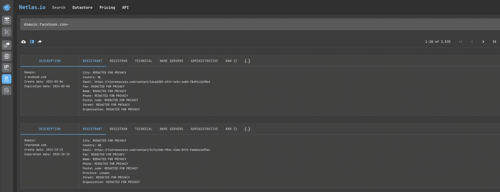

In **Domain WHOIS Search**, run a fuzzy search on a domain you monitor. For example, `~1` requests results within one edit of the given spelling.

```text
domain:netlas.io~1
```

Spelling similarity alone is a lead. Review registration dates, status and other evidence before attributing a result to phishing. For a spreadsheet, export the `domain`, `expiration_date`, and `status` fields as CSV. [Fuzzy search](https://docs.netlas.io/knowledge-base/query-language/#fuzzy-search) · [Domain WHOIS field reference](https://docs.netlas.io/knowledge-base/field-reference/whois_domains/)

You can open the exported CSV in Excel, Numbers, or Google Sheets.

### Favicon Search

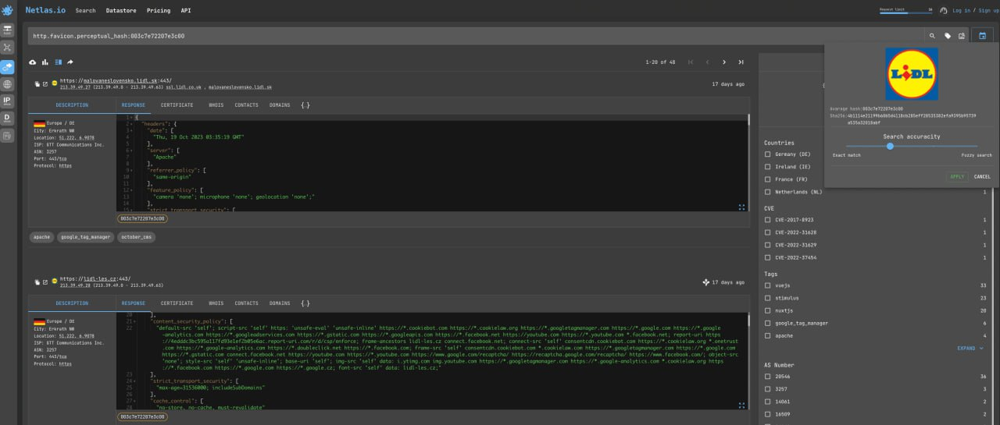

In **Responses Search**, use the favicon search control to upload a reference icon. Netlas supports SHA-256 to match identical bytes and a 64-bit perceptual hash to identify visually similar icons. For example, the second query allows one perceptual hash symbol to differ.

```text
http.favicon.perceptual_hash:00763c383c3c6e00
http.favicon.perceptual_hash:00763c383c3c6e00~1
```

A favicon match can identify related branding or shared software. Confirm relationships with independent evidence such as DNS history or certificate metadata. [Netlas favicon search](https://docs.netlas.io/knowledge-base/scanning-technology/#favicon-search)

### Search for Domains Associated with a Specific Subnet

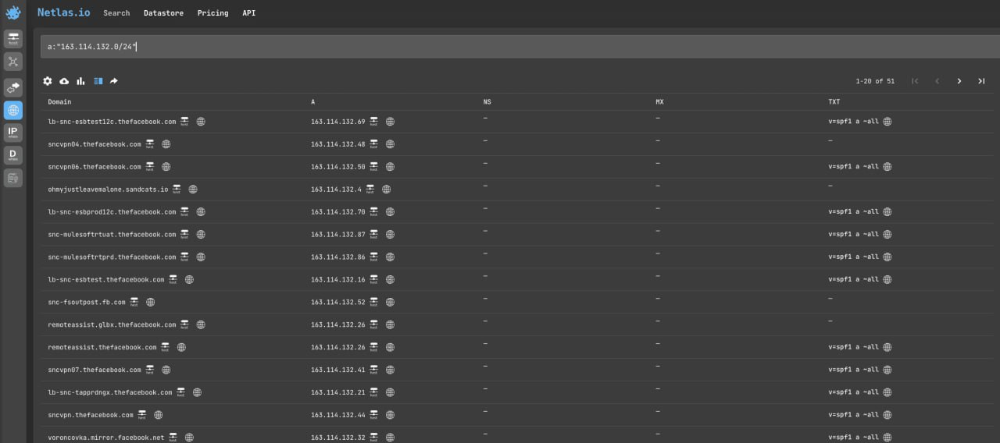

Search **DNS Search** for indexed IPv4 A records that fall within a CIDR block. This returns observations from the selected index and can miss uncollected domains. Use `aaaa` for IPv6 DNS records. [DNS field reference](https://docs.netlas.io/knowledge-base/field-reference/domains/) · [CIDR-based filtering](https://docs.netlas.io/knowledge-base/query-language/#cidr-based-ip-filtering)

```text
a:"163.114.132.0/24"
```

```bash
netlas search -d domain 'a:"163.114.132.0/24"' -f json
```

```bash
curl --fail --silent --show-error --get 'https://app.netlas.io/api/domains/' \
  --data-urlencode 'q=a:"163.114.132.0/24"' \
  --data-urlencode 'fields=domain' \
  -H "Authorization: Bearer $NETLAS_API_KEY" | jq -r '.items[].data.domain'
```

The [Python example](scripts/dfir/subnet_search.py) takes a network in CIDR notation and prints domain names from the first page.

```bash
python scripts/dfir/subnet_search.py 163.114.132.0/24
```

Source code.

```python
import argparse
import os
from ipaddress import IPv4Network

import netlas


parser = argparse.ArgumentParser(description="Find indexed DNS A records in a subnet.")
parser.add_argument("subnet", type=IPv4Network, help="IPv4 subnet in CIDR notation")
args = parser.parse_args()

client = netlas.Netlas(api_key=os.environ["NETLAS_API_KEY"])
result = client.search(query=f'a:"{args.subnet}"', datatype="domain", fields="domain")
for item in result.get("items", []):
    print(item["data"]["domain"])
```

<a id="search-for-servers-with-malicious-software"></a>

### Check an Incident Host for a Title Indicator

A page title can help corroborate an indicator on a host already identified in an incident. For example, a title containing `gophish` may indicate the GoPhish phishing simulation platform. The title can be changed or copied, and GoPhish also has legitimate uses. [GoPhish project](https://getgophish.com/) · [Netlas Responses field reference](https://docs.netlas.io/knowledge-base/field-reference/responses/)

```text
host:"example.com" AND http.title:gophish
```

Replace the example host with the exact hostname from your incident. The [Python example](scripts/dfir/malware_search.py) prints URI, title, and available country code.

```bash
python scripts/dfir/malware_search.py example.com
```

Source code.

```python
import argparse
import os
import re

import netlas


parser = argparse.ArgumentParser(description="Check an incident host for an indexed title indicator.")
parser.add_argument("host", help="exact ASCII hostname from an incident")
args = parser.parse_args()
host = args.host.lower().rstrip(".")
if not re.fullmatch(r"[a-z0-9-]+(?:\.[a-z0-9-]+)+", host):
    parser.error("host must be a hostname such as example.com")

client = netlas.Netlas(api_key=os.environ["NETLAS_API_KEY"])
result = client.search(
    query=f'host:"{host}" AND http.title:gophish', fields="uri,http.title,geo.country"
)
for item in result.get("items", []):
    data = item["data"]
    print(data.get("uri", ""), (data.get("http") or {}).get("title", ""),
          (data.get("geo") or {}).get("country", ""))
```

## Search for Technologies and Code Examples

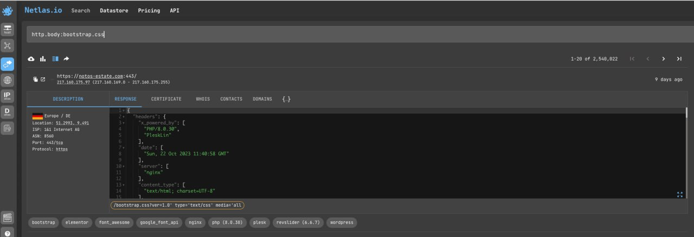

Responses Search can find terms from captured HTML using the tokenized `http.body` field. For example, search for Bootstrap references on pages that mention travel in their titles.

```text
http.body:bootstrap AND http.title:travel
```

When Netlas detects a known technology, use `tag.name` to search for its detection label. Check your plan's tag access if the query is restricted.

```text
tag.name:wordpress
```

A body match shows that a term appeared in a stored response. A detected technology tag is a separate signal from Netlas's detection rules. [Text fields](https://docs.netlas.io/knowledge-base/query-language/#text-fields) · [Technology detection](https://docs.netlas.io/knowledge-base/software-and-vulnerabilities/#technology-detection)

## Common Problems

### Error 429 - Too Frequent Requests

Netlas documents a limit of 60 requests per minute for ordinary search and count operations and 3 per minute for certificate search and count. For short-term throttling, Netlas returns `429 Too Many Requests` with a `Retry-After` delay. The SDK and CLI retry throttled requests by default. In raw HTTP clients, wait for `Retry-After` and cap the number of attempts. A `daily_request_limit_exceeded` response means the account or anonymous daily quota is exhausted. Wait for it to reset before sending more requests. [Netlas API rate limits](https://docs.netlas.io/api-reference/#section/Rate-Limits)

The [Python example](scripts/common_problems/rate_limit.py) sets the SDK retry count to two and handles `ThrottlingError` if those retries are exhausted.

```bash
python scripts/common_problems/rate_limit.py
```

Source code.

```python
import os

import netlas


client = netlas.Netlas(api_key=os.environ["NETLAS_API_KEY"])
try:
    result = client.search(query="host:example.com", fields="uri", retry=2)
except netlas.ThrottlingError as error:
    raise SystemExit(f"Netlas is still throttling requests. Retry in {error.retry_after} seconds.")

for item in result.get("items", []):
    print(item["data"]["uri"])
```

### KeyError

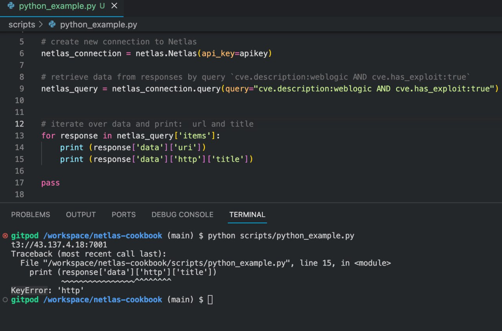

Another common problem is the lack of a specific key in response for some servers. For example, `['data']['http']['title']` is quite often missing.

```python
for item in result.get("items", []):
    http = item["data"].get("http") or {}
    print(http.get("title") or "No title")
```

### Automation of Work with the List of Requests

The [domain list example](scripts/common_problems/domain_list_search.py) reads [domains.txt](scripts/common_problems/domains.txt) from beside the script. Use one ASCII hostname or Punycode A-label hostname per line. The script runs exact **Domain WHOIS Search** queries and prints the domain and available registrar name. The example list uses [IANA example domains](https://www.iana.org/help/example-domains), so a lookup can return no records.

```bash
python scripts/common_problems/domain_list_search.py
```

For a file downloaded from a URL, see [Tor Exit Nodes Search](#tor-exit-nodes-search).

Source code.

```python
import os
import re
from pathlib import Path

import netlas


client = netlas.Netlas(api_key=os.environ["NETLAS_API_KEY"])
with Path(__file__).with_name("domains.txt").open(encoding="utf-8") as domain_file:
    for line_number, line in enumerate(domain_file, start=1):
        domain = line.strip().lower().rstrip(".")
        if not domain or domain.startswith("#"):
            continue
        if not re.fullmatch(r"[a-z0-9-]+(?:\.[a-z0-9-]+)+", domain):
            raise SystemExit(f"Invalid hostname in domains.txt on line {line_number}: {line.strip()}")
        result = client.search(
            query=f'domain:"{domain}"', datatype="whois-domain", fields="domain,registrar.name"
        )
        for item in result.get("items", []):
            data = item["data"]
            print(data["domain"], (data.get("registrar") or {}).get("name", ""))
```

### Saving Data in CSV Format

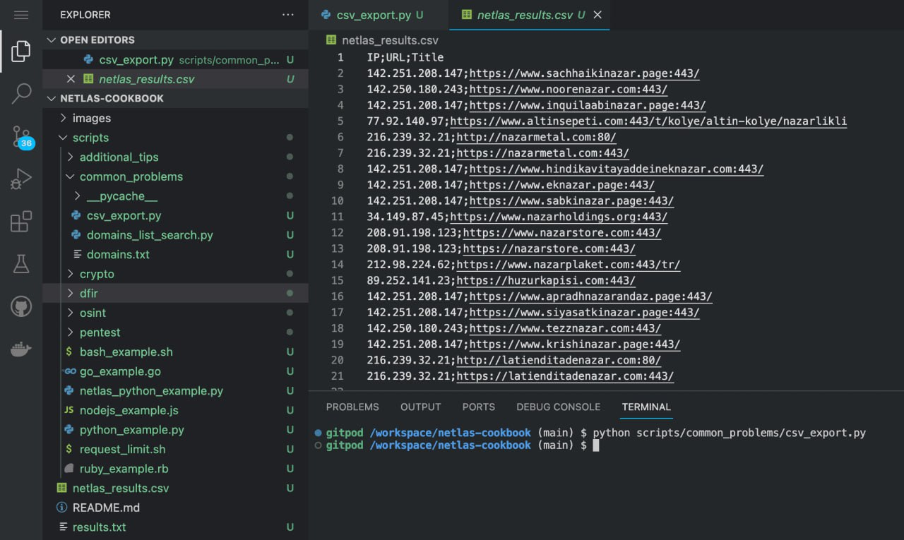

The [CSV example](scripts/common_problems/csv_export.py) writes IP, URI, and title to `netlas_results.csv` in the current directory. The [`csv` module](https://docs.python.org/3/library/csv.html) handles commas, newlines, and quoting in fields. The example prefixes formula-like cells with an apostrophe for spreadsheet display. When spreadsheet software offers an import dialog, import untrusted response columns as text. [OWASP CSV Injection](https://owasp.org/www-community/attacks/CSV_Injection)

```bash
python scripts/common_problems/csv_export.py
```

Source code.

```python
import csv
import os

import netlas


def spreadsheet_text(value):
    text = "" if value is None else str(value)
    if text.startswith(("\t", "\r", "\n")) or text.lstrip().startswith(("=", "+", "-", "@", "＝", "＋", "－", "＠")):
        return "'" + text
    return text


client = netlas.Netlas(api_key=os.environ["NETLAS_API_KEY"])
result = client.search(query="host:example.com", fields="ip,uri,http.title")

with open("netlas_results.csv", "w", encoding="utf-8", newline="") as output:
    writer = csv.writer(output)
    writer.writerow(["IP", "URL", "Title"])
    for item in result.get("items", []):
        data = item["data"]
        row = (data.get("ip"), data.get("uri"), (data.get("http") or {}).get("title"))
        writer.writerow([spreadsheet_text(value) for value in row])
```

### Saving Data in Other Formats

Using Python, you can generate a wide variety of documents based on data from Netlas, inserting images, data visualizations, and customizing the layout.

Use [XlsxWriter](https://xlsxwriter.readthedocs.io/) for Excel workbooks, [ReportLab](https://pypi.org/project/reportlab/) to generate PDFs, [python-pptx](https://python-pptx.readthedocs.io/) for PowerPoint presentations, or [python-docx](https://python-docx.readthedocs.io/) for Word documents.

### Decoding Punycode Domains

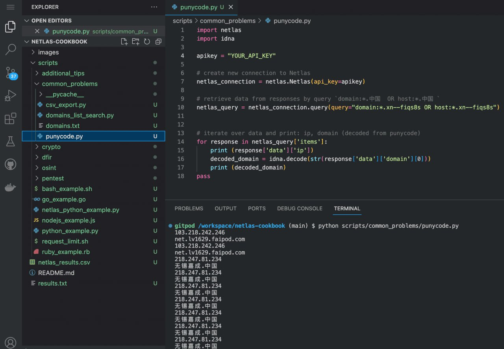

DNS Search uses the ASCII form of an internationalized domain name. The [Python example](scripts/common_problems/punycode.py) encodes `.中国` as `xn--fiqs8s` for the query, then displays each returned domain in Unicode using the [idna package](https://pypi.org/project/idna/).

```text
domain:*.xn--fiqs8s
```

```bash
python -m pip install idna
python scripts/common_problems/punycode.py
```

Source code.

```python
import os

import idna
import netlas


suffix = idna.encode("中国").decode("ascii")
client = netlas.Netlas(api_key=os.environ["NETLAS_API_KEY"])
result = client.search(query=f"domain:*.{suffix}", datatype="domain", fields="domain")
for item in result.get("items", []):
    domain = item["data"]["domain"]
    try:
        print(idna.decode(domain))
    except idna.IDNAError:
        print(domain)
```

### What to Do If Search Queries Don't Return Results?

1. Confirm the collection and field. Use `host` for the hostname in **Responses Search** and `domain` for the name in **DNS Search** or **Domain WHOIS Search**.
2. Verify field type and query syntax in the [search query language reference](https://docs.netlas.io/knowledge-base/query-language/). A phrase query such as `http.body:"hello world"` seeks the terms in order, while `http.body:(hello AND world)` allows any order.
3. Test one filter at a time before combining them. Review the scan or index you selected and whether your plan includes the field.
4. Treat zero hits as a statement about the selected dataset and filters. For known domains, check DNS and IP/Domain Info as additional sources.

### Removing HTML Tags from HTTP Body

The response body may include HTML tags, which can make it difficult to read in a terminal.

Responses can include captured HTML in `http.body`. The [Python example](scripts/common_problems/htmltotext.py) converts that content to readable Markdown with [html2text](https://pypi.org/project/html2text/) and skips items with no body.

```bash
python -m pip install html2text
python scripts/common_problems/htmltotext.py
```

Source code.

```python
import os

import html2text
import netlas


client = netlas.Netlas(api_key=os.environ["NETLAS_API_KEY"])
result = client.search(query="host:example.com AND http.body:*", fields="uri,http.body")
for item in result.get("items", []):
    data = item["data"]
    body = (data.get("http") or {}).get("body")
    if body:
        print(data.get("uri", ""))
        print(html2text.html2text(body))
```

## Attack Surface Management

Netlas's Attack Surface Discovery tool lets you start from a known asset and map its relationships using scan, DNS, WHOIS, and certificate observations. See the [Netlas Discovery guide](https://docs.netlas.io/quick-start/discovery/) for the workflow and plan availability.

## Working with Very Large Amounts of Data

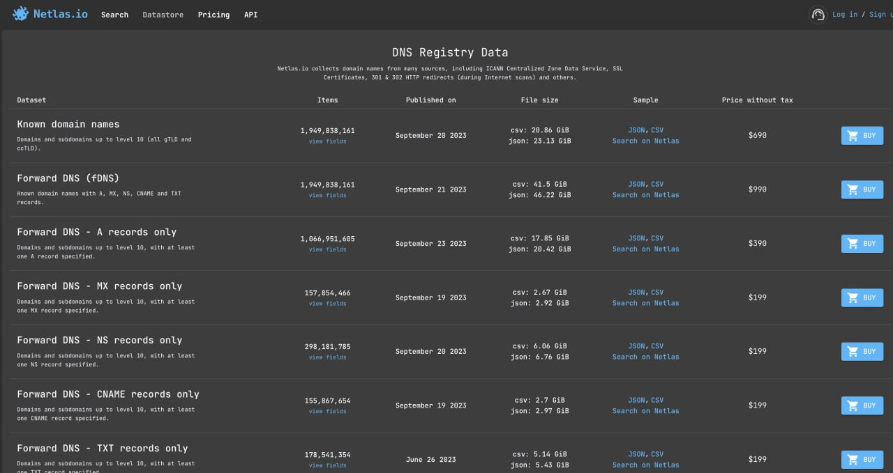

If you need to collect data on hundreds of thousands of domains, you can download a dataset and work with it on your own server.

For offline work, the [Netlas Datastore](https://app.netlas.io/datastore/) lists current datasets, sample files, formats, and access terms. The catalog includes DNS observations, scan data, and subdomain dictionaries. Dataset sizes and availability change with releases. A purchase covers one version. See the [Datastore guide](https://docs.netlas.io/quick-start/datastore/) for ongoing access options.

## Acknowledgments

Many thanks [@cyb_detective](https://twitter.com/cyb_detective) for help (https://cybdetective.com)
